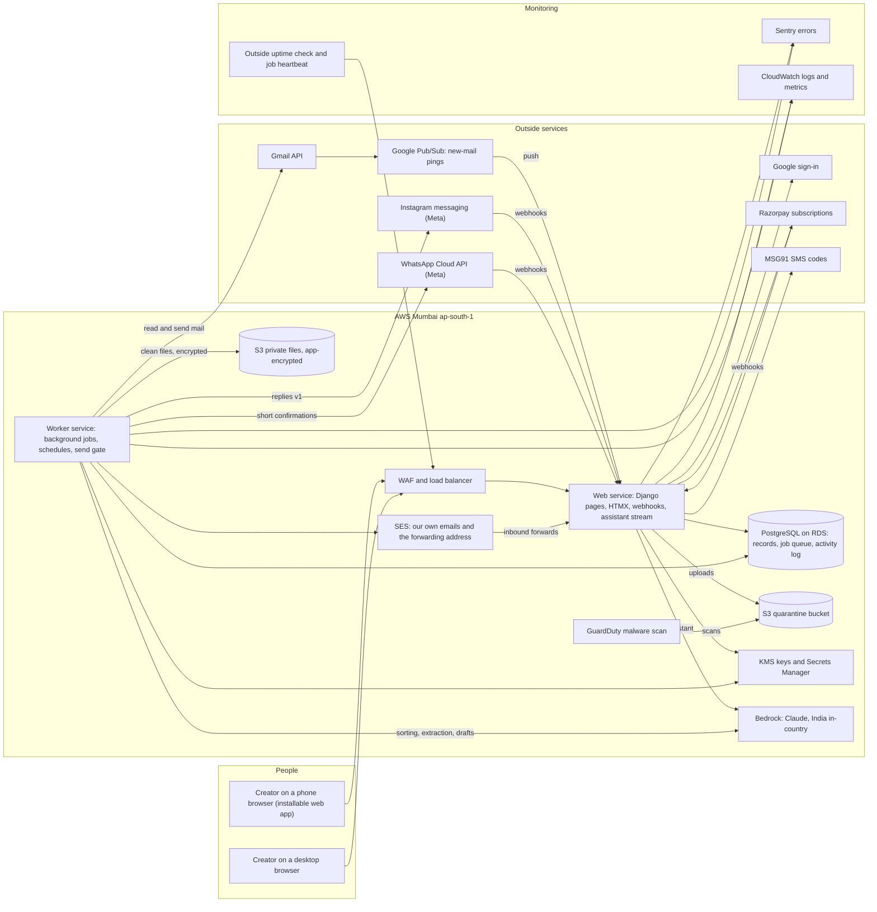
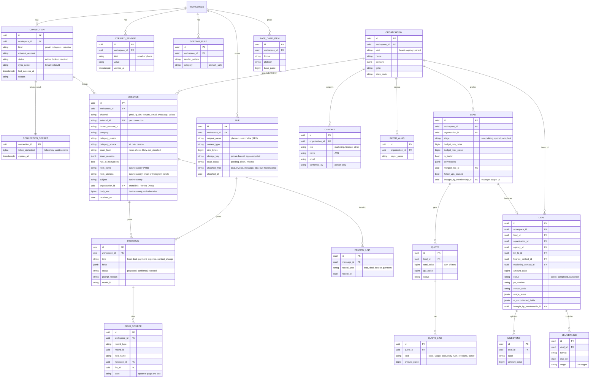
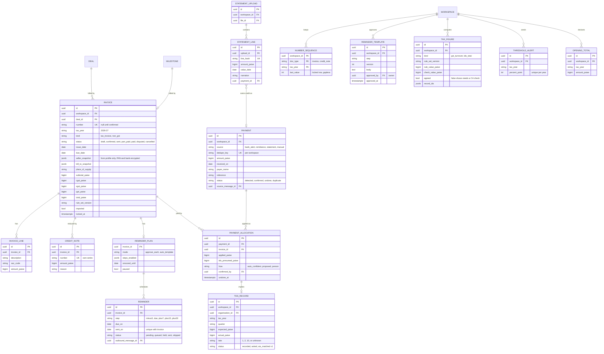
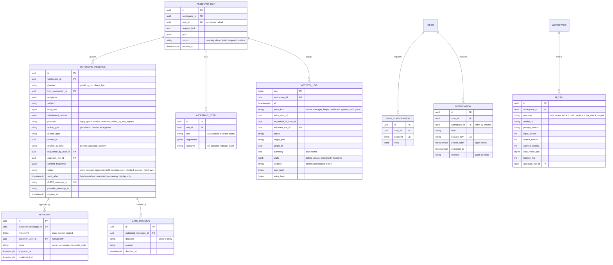
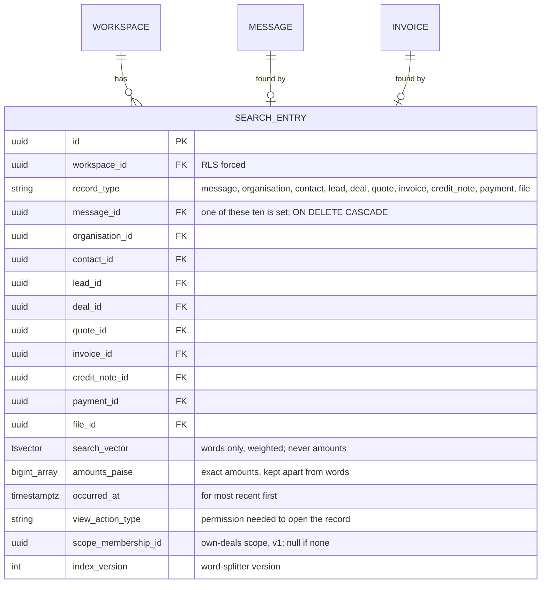
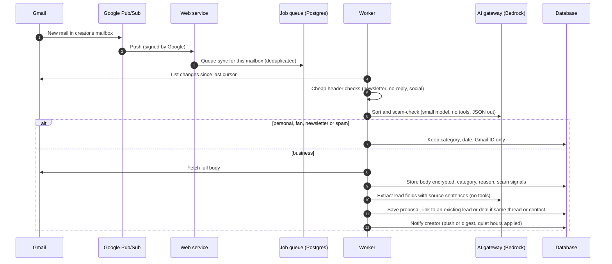
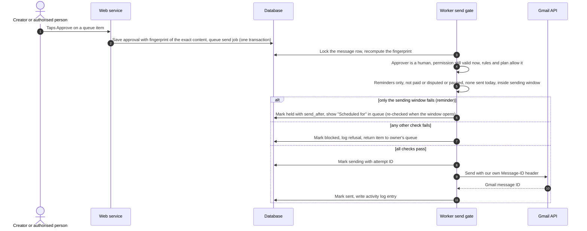

# BackstageHQ — Architecture

## 0. About this document

| | |
|---|---|
| Status | **Proposed. Draft for owner approval.** Not committed. |
| Stage | Stage 4 of `docs/PLAYBOOK.md` (3 = mockups, 4 = architecture). Older labels that say "Stage 3" (the `/architecture` command and the commit message of 1abed76) are wrong; history is left as it is. (Amended after mockups, AR1.) |
| Inputs | Approved `docs/02-prd/PRD.md` (FR / NFR IDs below refer to it) and approved `docs/01-usecases/use-cases.md` (amended after the PRD, edits E1–E9; after this architecture, P1; after the mockups, E10 and E12). Approved mockups in `docs/04-design/` (commit 0382fad). The mockups changed the PRD only through edits M1–M29 (commit 3f754e9, PRD section 14A); the resulting changes to this document are AR1–AR4, listed in section 27. (Amended after mockups, AR1.) The owner's decision of 2026-11-10 to put global search in the MVP added PRD edit M30 (FR-205, NFR-047, NFR-048, screen S-43); the resulting change here is AR5 (section 16A). (Amended after mockups, AR5.) |
| Decisions | One ADR per major decision in `docs/03-architecture/adr/` (index in section 29). All ADRs are **Proposed**. |
| Rule | This document does not change the PRD or the use cases. Where they need a change, it is listed in section 27 as a proposed edit. |

**How to read this document**
- Section 1: what the PRD fixes, and how the design answers each point.
- Sections 2–5: the picture, the stack, the rules we design by, the code layout.
- Section 6: the data model (Mermaid ERDs).
- Sections 7–18: how each concern works (flows, API, sign-in, permissions, isolation, encryption,
  jobs, AI, audit, files, global search (16A), billing, privacy).
- Sections 19–23: environments, CI/CD, tests, monitoring, backups.
- Section 24: **what it costs to run.**
- Section 26: **decisions only you can make** (marked **[Sign-off S#]** where they appear).
- Sections 27–28: proposed edits to earlier documents, open questions, and what was verified.

**Words used here**

| Word | Meaning |
|---|---|
| Workspace | One creator's business inside BackstageHQ (use-case glossary). Every business record belongs to exactly one. |
| Action | One change to data (e.g. "move deal to Won"), run through a single code path that checks permission, writes the activity log and records how to undo it. |
| Selector | One read of data (e.g. "money owed by age"), run through a single code path that hides what the person may not see. |
| Job | Work done in the background, not while the person waits (e.g. read new emails, send a reminder). |
| Send gate | The one piece of code allowed to send anything outside BackstageHQ (FR-236). |
| RLS | Row-level security: a database feature that refuses to return rows from another workspace, even if the app code has a bug. |
| KMS | Key Management Service: AWS's locked box for encryption keys. Our code never sees the master keys. |
| Paise | Money is stored as whole paise (₹1 = 100 paise), never as decimals, so rupee figures are always exact. |

---

## 1. What the PRD fixes, and how the design answers it

| PRD / use-case constraint | Design answer | Where |
|---|---|---|
| Nothing reaches a brand without a valid human tap or the owner's template opt-in (D6, D22, FR-236, M10 "zero, ever") | One send gate in the worker. It is the only code that can import the Gmail, Instagram and WhatsApp send clients (checked in CI). It re-checks the tap, the exact content and the person's permission **at the moment of sending**. | §7.2, §10, ADR-009 |
| Workspaces never mix (NFR-001, NFR-023) | `workspace_id` on every business row, Postgres RLS as a second lock, the workspace in every URL, and a test that fails if any new table lacks RLS. | §11, ADR-004 |
| Encryption in storage and transit; connection tokens encrypted and kept separately, never in logs (NFR-004, NFR-025) | Disk encryption everywhere, plus app-level encryption of PAN, GSTIN, bank numbers, message bodies and files. Tokens sit in a separate `vault` schema under a separate key that only the worker can use. | §12, ADR-005 |
| Every AI value has a source link; no AI amount enters money records without confirmation (NFR-009, NFR-014) | AI outputs are stored as **proposals** with per-field source spans. Only an Action confirmed by a person (or the strict confident-match rule, FR-144) turns them into records. | §6, §14 |
| Outside content is information, never commands (FR-239, UC-146) | AI calls that read emails or files have **no tools** and return checked JSON. Only a signed-in person's chat starts an assistant run. Assistant drafts may only address contacts already confirmed in the workspace. | §14.3, ADR-011 |
| Every log entry records the real actor and on whose behalf; log cannot be edited (FR-213, NFR-032, §12.4) | Append-only `activity_log`, written in the same database transaction as the change. The database refuses updates and deletes. | §15, ADR-010 |
| Reminders never misfire (NFR-008, FR-123) | Schedules are worked out from the data ("what is due and not yet done"), not from one-off timers. Database uniqueness rules make a second reminder for the same invoice on the same day impossible. | §13, ADR-006 |
| Never count a payment twice; numbers gapless per tax year (FR-145, FR-112) | Each payment has a unique dedupe key per source, and statement lines link to existing payments. Invoice numbers come from a locked counter inside the confirm transaction. | §6.3, ADR-013 |
| Swappable country tax rules (NFR-022, D1); company/LLP later (D15) | Tax, GST and TDS logic lives in versioned, pure-code rule packages per country. Every computed figure stores its rule version. Entity type is a profile field from day one. | ADR-014 |
| Tax figures cross-checked; "needs a CA check" on disagreement (FR-151) | Rule result and an independent AI check are both stored. The screen shows a number only when they agree. | §14 |
| Manager-ready from MVP (§12.4 of use cases, PRD §5.P) | Memberships with action-type grants and rules, actor + on-behalf-of on every action, payer separate from owner, one login with many workspaces. All of this ships in the MVP with only the owner role switched on. | §6.1, §10 |
| Scheduled jobs on time on 99.5% of days; uptime 99.5%; at most 1 hour of money data lost; back within 8 hours (NFR-012, NFR-042, NFR-043) | Managed database with point-in-time restore (about 5 minutes of loss at worst), backup copies in a second Indian region, a scheduler heartbeat alarm, and an outside uptime check. | §23 |
| Phone first, usable in 3 s on mid-range Android over 4G (NFR-007) | Server-rendered HTML with small JavaScript (HTMX). Hosting in Mumbai, close to users. Installable web app for push. | ADR-001 |
| AI or outside service down: app keeps working; send gate and template reminders need no AI (NFR-044, NFR-045) | AI sits behind one gateway with a circuit breaker. Template reminders and the send gate never call AI. Each connection shows "paused since". | §14.5 |
| DPDP erasure within the published period; backups age out within 90 days (NFR-005) | A deletion job runs at day 30. Database backups are kept 14 days and file versions 30 days, so every copy is gone well inside 90 days. | §18, §23 |
| Cost to run ≤ 30% of price (M14, NFR-018) | Cheapest model that passes each test set, one AI gateway that meters every call per workspace, allowance and fair-use caps enforced before calling AI, and a small fixed footprint. | §14.6, §24 |
| Global search finds only what the workspace stores, never another workspace, a personal message or a hidden field; typed words are never kept (FR-205, NFR-047, NFR-048) (Amended after mockups, AR5.) | One `search_entry` table inside PostgreSQL holding only plaintext business fields, under the same forced RLS. Search requests are `POST`, never logged; role filters are applied in the query so counts never include hidden records. No AI, no extra system. | §16A, ADR-020 |
| No India-residency promise, regions listed (D11, NFR-006) | Primary data and AI processing in India (Mumbai, Hyderabad backups). Other processors listed on the privacy page. This is a fact we publish, not a promise. | §24, §26 |

---

## 2. Architecture in one picture

**In plain words.** There are two running programs built from the same code. The **web service**
shows pages, receives webhooks from Google, Meta and Razorpay, and streams assistant answers. The
**worker** does everything slow or risky in the background: reading mailboxes, calling the AI,
matching payments, sending reminders, and every outbound message through the send gate. Both
share one **PostgreSQL database**, which also holds the job queue and the activity log, so there
is no extra queue system or cache to run. Files go first into a quarantine bucket, are scanned for
malware, and are then encrypted and moved to the private bucket. Everything runs in AWS Mumbai.
The AI runs on Claude through Amazon Bedrock's India in-country option, so creator emails sent to
the AI are processed in India too.

---

## 3. Stack choice

Each choice is the boring, well-supported option for a small team whose code is written by AI
builders and read by a non-programmer owner.

| Layer | Choice | Why (one line) | Main alternative | ADR |
|---|---|---|---|---|
| Language | **Python 3.13** | Most readable mainstream language. Strongest libraries for PDFs, bank statements, Excel and AI. | TypeScript | 001 |
| Web framework | **Django 5.2 LTS** | 20 years old, with built-in sign-in, sessions, CSRF protection, admin and **reversible migrations**. Security fixes until April 2028. | Next.js | 001 |
| Front end | **Server-rendered HTML + HTMX + a little Alpine.js**, installable web app (PWA) | Small pages load fast on mid-range Android. Stage 3 HTML mockups become templates almost directly. One language. | React SPA | 001 |
| CSS | Tailwind CSS (standalone CLI, no Node) | Mobile-first utility classes. The mockup designer and builders all know it. | Plain CSS | 001 |
| Database | **PostgreSQL 17 on Amazon RDS** | Exact money maths, transactions, row-level security, full-text search, point-in-time restore. | Aurora Serverless | 003 |
| Search | **PostgreSQL full-text search** on one `search_entry` table (with the `btree_gin` extension) (Amended after mockups, AR5.) | No search engine to run, back up or secure; the same RLS isolates it; costs nothing per search. | OpenSearch | 020 |
| Background jobs | **Procrastinate** (job queue stored in PostgreSQL) behind our own thin `jobs` module | A job is queued in the same transaction as the change, so jobs are never lost or phantom. No extra system to run. | Celery + SQS | 006 |
| Hosting | **AWS ap-south-1 (Mumbai)**: ECS Fargate containers, ALB, RDS, S3, KMS, Secrets Manager | Managed, no servers to patch. Same region as users and as the India in-country Claude service. **[Sign-off S1]** | Google Cloud Run; Render | 002 |
| AI | **Claude on Amazon Bedrock, India in-country profile**: Haiku 4.5 for sorting and scam signals, Sonnet 5 for extraction, drafts and the assistant | Hindi/Hinglish quality and vision for screenshots. AWS terms: no training, no sharing with the model maker. Processing stays in India. **[Sign-off S2]** | Anthropic API direct; Gemini on Vertex | 011 |
| Sign-in | Django auth + **django-allauth** (Google) + **MSG91** SMS codes + email codes; server-side sessions | Sessions we can end instantly (NFR-027, FR-262). India-registered SMS templates (A8). **[Sign-off S6]** | AWS Cognito; Firebase Auth | 012 |
| Our own email | **Amazon SES** (Mumbai) for digests, alerts and invites; SES inbound for the forwarding address | Same cloud and region, very cheap. Brand messages never use it: they go from the creator's Gmail. **[Sign-off S7]** | Postmark | 015 |
| Subscriptions | **Razorpay Subscriptions** (UPI Autopay, cards) | The standard Indian gateway for recurring UPI. Stripe India is not open to new merchants. | Cashfree | 016 |
| PDFs / Excel | WeasyPrint (HTML to PDF, Noto fonts for ₹ and Devanagari), openpyxl, pikepdf / pdfplumber (statements, AIS) | Invoice layout reuses the HTML from Stage 3. Mature Python libraries. | Headless Chrome | 013 |
| Malware scan | **GuardDuty Malware Protection for S3** | Fully managed, priced per GB scanned. No antivirus server to keep updated. | ClamAV container | 005 |
| Web push | pywebpush with VAPID keys | Standard Web Push. Works on iPhone once the app is added to the home screen (D2). | A push SaaS | — |
| Feature flags | django-waffle | Switches Instagram on when Meta approves, and gives a "forwarding-only" mode for Gmail (D33). | Env vars | — |
| Infra as code | **Terraform** in `infra/` | The environment can be rebuilt from code (8-hour recovery target, NFR-043). | AWS CDK | 019 |
| CI/CD | **GitHub Actions**, OIDC to AWS (no stored keys) | Free for this size. Playbook requires lint, type-check, tests and audit on every push. | — | 019 |
| Errors / logs | **Sentry** (personal data scrubbed) + CloudWatch structured logs + outside uptime monitor + heartbeat | Errors with context, logs we can search, and alarms that work even if AWS is down. | Self-hosted GlitchTip | 018 |
| Python tooling | uv (locked dependencies with hashes), ruff, mypy, pytest, Hypothesis, time-machine, Playwright, import-linter | Standard 2026 Python toolchain. Each tool has one job. | Poetry, flake8 | 019 |

**What this locks us into, in plain words.** Python and Django are the hardest thing to change
later: switching language means rewriting. Both are among the most widely used, so this is a safe
lock. AWS is the second hardest: moving clouds would take weeks, but nothing here is
AWS-exotic. It is containers, PostgreSQL and files, which run anywhere. Bedrock and Razorpay sit
behind one module each, so switching either touches one folder.

---

## 4. Rules the design follows

1. **One door for changes.** Every write goes through an Action: permission check, the change,
   the activity log entry and the undo record, all in one database transaction. Screens, the
   assistant and jobs all use the same Actions. A guard makes saving a business record outside
   an Action fail in tests (ADR-007).
2. **One door for reads that matter.** Screens, the assistant, exports and the year-end pack get
   numbers from the same Selector functions. "Who owes me" on the Money screen, in the assistant
   (FR-231 AC1) and in the export (FR-210 AC1) are the same function, so they cannot disagree.
3. **One door out.** Only the send gate can send to the outside world (ADR-009).
4. **One door to AI.** Only the AI gateway calls a model. It meters cost per workspace, enforces
   allowances and stops runaway costs (ADR-011).
5. **Workspace on every row, in every URL, in every job.** Requests and jobs name the workspace
   they act for. The database checks it again (ADR-004).
6. **Outside content is data.** Email, DM, file and webhook content never chooses an action, a
   recipient or a bank account (FR-239).
7. **Schedules come from state.** Jobs ask "what is due and not done yet?" rather than trusting
   timers. A missed run catches up on the next tick. Uniqueness rules stop doubles (ADR-006).
8. **Proposals before records.** AI and imports create proposals. People (or the single strict
   confident-match rule) turn them into records (NFR-009).
9. **Expand, then contract.** Database changes never break the version of the app already
   running, so any release can be rolled back (ADR-017).

---

## 5. Code layout (`app/`)

One Django project (a "modular monolith": one program, cleanly divided folders). Each folder owns
its tables and exposes Actions and Selectors. Folders do not reach into each other's tables.

| Module | Owns | Notes |
|---|---|---|
| `accounts` | users, sign-in methods, trusted devices, sessions, second checks | Global (not per workspace) |
| `workspaces` | workspace, memberships, permission grants, the **policy** (`authorize()`) | Policy is one file, table-driven |
| `profile` | business profile, bank accounts, handles, rate card, default terms, opening totals | Sensitive fields encrypted |
| `connections` | Gmail, Instagram, WhatsApp senders, forwarding address, Calendar (v1), token vault | Only module that touches provider APIs, except sending (see `outbound`) |
| `inbox` | messages, sorting, sorting rules, scam signals, sender trust | Keeps only business content (FR-044) |
| `capture` | uploads, forwards, AI proposals with per-field sources | |
| `crm` | organisations (brand, agency, parent), contacts, payer aliases, leads, quotes, deals, milestones, deliverables | |
| `invoicing` | invoices, credit notes, numbering, PDFs | Locked after send (FR-113) |
| `collections` | reminder plans, reminder steps, templates | |
| `payments` | payments, allocations (matches), TDS records, statements | Idempotent records |
| `tax` | threshold watch, tax figures with cross-check, (v1) AIS, year-end pack | Uses `rules` |
| `rules` | pure-Python country rule packages: `rules/in/v2026_1/` | No Django imports (checked) |
| `outbound` | outbound messages, approvals, gate decisions, **the send gate** | Only importer of provider send clients |
| `assistant` | runs, steps, tool definitions (generated from Actions) | |
| `audit` | activity log, undo engine, hash chain | Append-only |
| `notifications` | push subscriptions, notifications, quiet hours, daily digest | |
| `ai` | gateway, prompt templates (versioned), usage metering, eval harness | Only importer of the Bedrock client |
| `files` | storage, encryption helpers, malware-scan intake | Only user of KMS |
| `billing` | subscriptions, entitlements, Razorpay webhooks, BackstageHQ's own invoices | Platform-level |
| `platform` | staff access grants, exports, deletions, retention purge, internal price-test report (S-30), invariant monitors | |
| `jobs` | thin wrapper over Procrastinate: queues, locks, retry policy | Lets us swap the queue library |
| `search` | the `search_entry` table, the word splitter and amount reader (pure Python), the search Selector and view (Amended after mockups, AR5.) | Owns no business data: each module supplies its own records' searchable words through a `search.py` file in its own folder (§16A) |

**Checked boundaries (import-linter in CI).** `rules` imports nothing from Django. Only
`outbound.gate` imports `connections.*.send_client`. Only `ai.gateway` imports the Bedrock SDK.
Only `files.crypto` imports KMS. Views import Actions and Selectors, never models of another
module. `search.tokenize` and `search.amounts` import nothing from Django, like `rules`, and no
module's `search.py` may read a column ending in `_enc` (checked by a test, §16A). (Amended after
mockups, AR5.)

---

## 6. Data model

### 6.1 Conventions

| Topic | Rule | Why |
|---|---|---|
| IDs | UUIDv7, generated in the app | Safe in URLs (no counting other people's records), sort by time |
| Tenancy | Every business table has `workspace_id NOT NULL`, RLS enabled **and forced** | NFR-023 |
| Money | `BIGINT` in paise, column suffix `_paise`, plus `currency CHAR(3)` on documents (default `INR`) | Exact. Ready for other currencies in v2 (D1) |
| Time | `timestamptz` stored in UTC. Business dates are `date` in the workspace time zone (default `Asia/Kolkata`). Tax year is computed by the rule package. | Quiet hours, due dates and the April–March year are correct |
| Encryption | Columns ending `_enc` hold AES-256-GCM ciphertext under the workspace key, bound to (workspace, table, column, row) | §12 |
| Versioning | Business rows have `version INT` (optimistic locking) | "Undo" can warn when later edits sit on top (FR-238) |
| AI provenance | AI-filled fields are listed in `ai_unconfirmed_fields`, with sources in `field_source` | FR-080 AC1, NFR-014 |
| Soft vs hard delete | Records are hard-deleted when the person deletes them, except documents the law requires (issued invoices, credit notes), which can only be cancelled | FR-211 AC2 |
| Snapshots | On confirmation an invoice copies seller details (from profile) and bill-to details into frozen columns | A later profile change never alters an issued invoice |

### 6.2 Identity, workspaces, billing

```mermaid
erDiagram
    USER ||--o{ AUTH_IDENTITY : "signs in with"
    USER ||--o{ TRUSTED_DEVICE : has
    USER ||--o{ USER_SESSION : has
    USER ||--o{ MEMBERSHIP : "joins through"
    WORKSPACE ||--o{ MEMBERSHIP : has
    USER ||--o{ WORKSPACE : owns
    MEMBERSHIP ||--o{ PERMISSION_GRANT : holds
    WORKSPACE ||--|| WORKSPACE_KEY : "encrypted with"
    WORKSPACE ||--|| BUSINESS_PROFILE : has
    WORKSPACE ||--o{ BANK_ACCOUNT : has
    WORKSPACE ||--o| SUBSCRIPTION : "billed by"
    USER ||--o{ SUBSCRIPTION : "pays for"
    SUBSCRIPTION ||--o{ BILLING_EVENT : receives
    SUBSCRIPTION ||--o{ PLATFORM_INVOICE : produces
    WORKSPACE ||--o{ STAFF_ACCESS_GRANT : allows
    WORKSPACE ||--o{ SHARE_LINK : issues

    USER {
        uuid id PK
        string phone_e164 UK "verified"
        string email UK "verified"
        string display_name
        bool is_staff
        timestamptz created_at
    }
    AUTH_IDENTITY {
        uuid id PK
        uuid user_id FK
        string provider "phone, google, email"
        string subject UK
    }
    TRUSTED_DEVICE {
        uuid id PK
        uuid user_id FK
        bytea device_token_hash UK
        timestamptz last_sign_in_at "second factor again after 30 days"
    }
    USER_SESSION {
        string session_key PK
        uuid user_id FK
        timestamptz last_seen_at
        string device_summary
    }
    WORKSPACE {
        uuid id PK
        uuid owner_user_id FK "always the creator"
        string country_code "IN"
        string timezone
        string status "active, deletion_pending, deleted"
        timestamptz created_at
    }
    MEMBERSHIP {
        uuid id PK
        uuid workspace_id FK
        uuid user_id FK
        string role_preset "owner, manager, editor, accountant, helper"
        string status "invited, active, revoked, left, expired"
        bigint amount_limit_paise "rule, v1"
        string deal_scope "all or own, v1"
        bool hide_deal_values "v1"
        bool read_only "v1"
        timestamptz ends_at "v1"
        uuid invited_by FK
    }
    PERMISSION_GRANT {
        uuid id PK
        uuid membership_id FK
        string action_type "e.g. send_invoices"
        uuid granted_by FK
    }
    WORKSPACE_KEY {
        uuid workspace_id PK
        bytea wrapped_dek "wrapped by KMS data key"
        int key_version
    }
    BUSINESS_PROFILE {
        uuid workspace_id PK
        string legal_name
        string entity_type "individual, sole_prop; company later"
        bytea pan_enc
        bytea gstin_enc
        string state_code
        string invoice_prefix
        int default_terms_days
    }
    BANK_ACCOUNT {
        uuid id PK
        uuid workspace_id FK
        bytea account_number_enc
        string ifsc
        string holder_name
        bool is_payout
    }
    SUBSCRIPTION {
        uuid id PK
        uuid workspace_id FK
        uuid payer_user_id FK "separate from owner"
        string plan "free, paid"
        string price_point "test arm A or B"
        string status "trialing, active, past_due, grace, free"
        timestamptz trial_ends_at
        timestamptz current_period_end
        string provider_subscription_id UK
    }
    BILLING_EVENT {
        uuid id PK
        string provider_event_id UK "idempotency"
        jsonb payload
        timestamptz processed_at
    }
    PLATFORM_INVOICE {
        uuid id PK
        uuid subscription_id FK
        string number UK "BackstageHQ series"
        bigint total_paise
    }
    STAFF_ACCESS_GRANT {
        uuid id PK
        uuid workspace_id FK
        uuid staff_user_id FK
        uuid granted_by FK "owner, after second check"
        timestamptz expires_at "granted + 24 h"
        timestamptz ended_at "owner ended early"
        string reason "one support case"
    }
    SHARE_LINK {
        uuid id PK
        uuid workspace_id FK
        bytea token_hash UK
        string purpose "ca_year_end_pack v1, brand_portal later"
        timestamptz expires_at
        timestamptz revoked_at
    }
```

### 6.3 Connections, inbox, capture, CRM, deals

**Added for global search (Amended after mockups, AR5.)** `message.from_name` keeps the sender's
display name next to `from_address` (business messages only, null otherwise, like `subject`).
`message.organisation_id` records the brand link that FR-041 already makes, so a message can be
found by its brand. `contact.name` holds the contact's name. The `file` table was implied by
section 16 but not drawn; the file's name stays plaintext so it can be listed and searched, while
the file content stays encrypted (§12).

**Minimal storage of personal mail (FR-044).** For messages sorted as fan, personal, newsletter or
spam, the `MESSAGE` row keeps only `category`, `received_on`, `channel` and `external_id`. Sender,
subject and body stay null. The `external_id` is needed to fetch the email again from Gmail if the
creator re-sorts it (FR-044 AC2) and to avoid reading it twice. The PRD says "only category and
date". Keeping the provider ID is a proposed clarification (edit P1, section 27).

### 6.4 Invoicing, collections, payments, tax

### 6.5 Outbound, assistant, audit, notifications, AI usage

Platform tables outside any workspace (no RLS, never hold creator business content):
`inbound_event` (raw webhooks, provider event ID unique, purged after processing; unverified
WhatsApp senders after 24 h per FR-013 AC2, unverified forwards after 7 days per FR-011 AC2),
`export_request`, `deletion_request`, the Procrastinate job tables, `waffle` flags, and
`billing_event`.

### 6.6 Ready for v1 and later without a rebuild (use cases §12.4)

| Must allow from day one | How the model allows it |
|---|---|
| Exactly one owner; only the owner transfers ownership | `workspace.owner_user_id`. Transfer is an owner-only Action with a second check. |
| Payer separate from owner | `subscription.payer_user_id`. Paying creates no membership and no grant. |
| One login, many workspaces, each with its own permissions | `membership` per (user, workspace). Workspace ID in every URL (§11). |
| Permissions as action types plus rules, checked at the moment of action | `permission_grant` + rule columns on `membership`. `authorize()` runs at action and send time (§10). |
| No assumption of one manager, or that a manager is one person | Any number of memberships per workspace. A later "manager organisation" (ML-01) adds a nullable `org_id` on membership. |
| Real actor and on-whose-behalf on every entry | `activity_log.actor_kind`, `actor_user_id`, `on_behalf_of_user_id`, `assistant_run_id`. |
| Cross-workspace features need each creator's consent | No query crosses workspaces except the narrow database functions in §11.3. A roster view (M2-08) would be a new, consent-gated function. |
| Outside-party identity (brand guest) | `share_link` (token, purpose, expiry, revoke) and actor kind `guest`. The v1 CA link (FR-156) is the first use. A brand portal (M2-14) adds purposes. |
| Commission as its own record, separate from payouts | v1 tables `commission_rule`, `commission_override`, `commission_statement`, `commission_line` (with dispute flag). No payout table. |
| A manager can own their own workspace | Users are global. A manager simply also has an owner membership elsewhere. |

v1 tables, added by migrations when scheduled: `invitation`, commission tables, `ais_upload`,
`ais_entry`, `tds_certificate`, `expense`, `barter_item`, `vendor_document`,
`calendar_event_link`, deliverable stage history.

### 6.7 Search index (Amended after mockups, AR5.)

One row per searchable record. It is a **derived copy** of plaintext fields that already exist
elsewhere, so it can be rebuilt from the records at any time and dropping it loses nothing. Only
two records are drawn above; each of the ten foreign keys points at its own table, exactly one is
set (a `CHECK` rule), each is unique, and each deletes the entry when its record is deleted.
Details in section 16A.

---

## 7. Key flows

### 7.1 A brand email arrives and becomes a lead

Push normally arrives within seconds. A backup poll every 4 minutes means even a lost ping is
picked up inside the 5-minute target (FR-010 AC1). The poll is cheap: one small Gmail call per
mailbox.

### 7.2 Approve and send through the gate

### 7.3 A payment is detected

1. A bank-alert email is sorted as "invoice or payment". The worker extracts amount, date, payer
   and reference as a proposal with sources.
2. `payments.record_detected` builds a dedupe key from the Gmail message ID. A later statement
   line with the same amount, a value date within ±2 days, and a matching reference or payer is
   linked to this payment, not added (FR-145).
3. The matcher applies the **confident** rule exactly as FR-144 (payer is brand or linked payer;
   amount equals invoice or invoice minus 1/2/10% TDS; reference contains the number or it is the
   only open invoice of that amount). Confident matches auto-confirm unless the owner chose
   "always ask me". Everything else becomes a proposal.
4. Confirming an allocation locks the invoice row, sets status, records TDS, and cancels pending
   reminders, all in one transaction. The send gate also re-checks "not paid" at send time, so a
   reminder already queued cannot go out after a match (FR-123 AC1).
5. Undo reverses the allocation and TDS record, and recomputes reminder steps from today. Steps
   whose date has passed are skipped (FR-146).

### 7.4 An assistant run

1. A signed-in person types a request. The web service starts an `assistant_run` for that person
   in the open workspace and checks the monthly allowance (FR-234).
2. The model is offered only the tools (Actions and Selectors) that this person may use, already
   intersected with the assistant rules (FR-235). It never sees a "send" tool. "Draft an email"
   creates a queue item.
3. Each tool call runs through the normal Action path: permission check, change, log entry tagged
   "Assistant for <person>", undo record. Money confirmations come back as confirmation cards for
   the person's tap.
4. The run streams progress to the panel (server-sent events) and ends with a report and "Undo
   this run", which reverses the run's log entries newest first and withdraws its queued items.
   If a record's `version` moved since, it warns first (FR-238).

---

## 8. API style

| Surface | Style | Notes |
|---|---|---|
| The app (all screens) | **HTML over the wire**: Django views render pages; HTMX swaps page fragments; normal form posts | No public JSON API in MVP. Session cookie + CSRF token. |
| URLs | `/w/<workspace_id>/<area>/<record_id>` | The workspace is explicit in every request, so two tabs on two workspaces cannot mix (FR-273). |
| Assistant | `POST` to start a run, then a **server-sent events** stream for tokens and step updates | Runs in the web service (async). Heavy steps (exports) are queued. |
| Global search (FR-205, S-43) (Amended after mockups, AR5.) | `POST /w/<workspace_id>/search` with form fields `q` (the typed words), optional `type` (one group, for a type chip or "Show all") and `offset` (next 50 in "Show all"). Returns an HTML fragment. `GET /w/<workspace_id>/search/brand/<organisation_id>` returns the MVP brand results list. | Words travel only in the request body, never in a URL, so no access log can hold them (NFR-048). Responses are `Cache-Control: no-store`. Same session, CSRF and workspace checks as every screen. Details in §16A. |
| Live updates (import progress, queue counts) | HTMX polling every few seconds | Simple and good enough at this scale. No websockets. |
| Inbound webhooks | `/hooks/gmail` (Pub/Sub push, Google-signed JWT), `/hooks/meta` and `/hooks/whatsapp` (`X-Hub-Signature-256`), `/hooks/razorpay` (HMAC signature), `/hooks/ses` (SNS signature) | Verify the signature, store raw in `inbound_event` with a unique provider event ID, return 200, process in a job. Replays are ignored. |
| Health | `/health/live`, `/health/ready` (database reachable, migrations current) | Used by the load balancer and the outside uptime check. |
| Future native app or brand portal | `/api/v1` JSON with **Django Ninja** (OpenAPI spec), token auth | Added when the native-app trigger (D39) or the portal (M2-14) arrives. It calls the same Actions and Selectors, so it adds endpoints without new logic. |

Assistant tools are generated from the Action and Selector registry (name, description, input
schema, required permission). The assistant's list is the FR-233 list. Adding a tool means
adding a tested Action, never free-form database access.

---

## 9. Authentication

| Need | Design |
|---|---|
| Sign up / sign in (FR-001) | Phone + 6-digit SMS code (MSG91, DLT-registered template), or Google (allauth, OpenID Connect). Codes are stored hashed, expire in 5 minutes, and 5 wrong tries lock sign-in for 15 minutes (logged). Email code is a fallback and a second factor. |
| Second factor on a new device (FR-002, NFR-004) | A long-lived random device cookie, stored hashed in `trusted_device`. With no known device, or more than 30 days since the last sign-in on it, the app asks for a second factor **of a different kind** (Google then phone code, phone then email code or Google) before showing any data. |
| Sessions (NFR-027) | Server-side sessions in Postgres. End after 30 days without activity. "Sign out everywhere" deletes the rows, which takes effect at once. Revoking a manager (v1) deletes their sessions **for that workspace** by removing the membership. Every request re-checks membership. Cookies: `Secure`, `HttpOnly`, `SameSite=Lax`; HSTS on. |
| Second check for sensitive actions (FR-004, FR-210, FR-212, S-29) | A one-time code to the verified phone or email. Success grants a single-use step-up token bound to that session and that purpose for 5 minutes. Bank, PAN, GSTIN changes also notify the owner by email and in-app. |
| Account recovery (UC-001 edge case, E9) | Lost phone: recover with email code **and** Google (two independent factors). Lost both: no recovery through support alone (documented on the help page). |
| Staff | Separate admin sign-in with an authenticator app or passkey (allauth MFA). Staff accounts hold no workspace access by default (§10.5). |
| Abuse limits (NFR-028) | AWS WAF rate rules at the edge, plus per-phone, per-IP and per-user counters in the app. The forwarding address and WhatsApp number have per-sender caps, and our team is alerted. |

---

## 10. Authorization (roles and permissions)

### 10.1 Model

- A **role preset** (owner, manager, editor, accountant, helper) is only a starting set of
  **action types**. What counts is the `permission_grant` rows plus the rule columns on the
  membership (amount limit, own-deals scope, hide values, read-only, end date).
- The **owner** implicitly holds every action type. **Never-delegable** actions (FR-268) are a
  fixed list in code, are not grantable, and are refused for anyone but the owner. Some also need
  a second check.
- `authorize(actor, workspace, action_type, resource, context)` returns one of **ALLOW**,
  **QUEUE** (send to the owner's approval queue), **STEP_UP** (needs a second check) or **DENY**.
  The PRD rule "stricter rule wins" is the evaluation order.
- It is called **at the moment of action**: when an Action runs, and again in the send gate when a
  message leaves (FR-236 AC3, FR-265 AC2).

### 10.2 Action types (from PRD §7.2)

| Group | Action types |
|---|---|
| Delegable (ticks) | `view_deals`, `edit_deals`, `view_inbox` (follows `view_deals`, business categories only, E4), `view_money_totals`, `view_bank_tax`, `create_invoice_drafts`, `send_invoices` (also covers issuing numbers, marking paid, recording TDS, E4), `send_reminders`, `reply_to_brands`, `accept_deals` (with amount rule), `approve_contracts`, `change_rate_card`, `invite_others`, `download_reports` |
| Owner only, never delegable | `change_payout_bank`, `change_pan_gstin`, `delete_data`, `disconnect_source`, `delete_account`, `transfer_ownership`, `remove_owner`, `full_export`, `change_automation_settings`, `change_permissions`, `grant_staff_access` (Amended after mockups, AR3) |
| Owner only, second check | `change_payout_bank`, `change_pan_gstin`, `full_export`, `delete_account`, `transfer_ownership`, `grant_staff_access` (Amended after mockups, AR3) |

In the MVP only the owner exists, but every Action already declares its action type and every
check already runs. That is how the MVP tests the manager foundation (PRD §5.P).

### 10.3 The assistant overlay (FR-235)

The assistant acts as `Actor(kind=assistant, on_behalf_of=<person>)`. Its rights are the
person's rights **intersected** with a fixed table:

| Assistant wants to | Result |
|---|---|
| Read, answer, draft | As the person |
| Internal record updates (stage, category, notes) | As the person, alone, with undo |
| Money confirmations (issue number, mark paid, record TDS) | Confirmation card; the person's tap runs it |
| Delete, disconnect, access, settings, export | Confirmation card; the person's tap runs it (owner-only items stay owner-only) |
| Send anything outside | Never. It can only create a queue item. Its approval is never accepted by the gate. |
| Bank, PAN, GSTIN; never-delegable; its own permissions | Always DENY, with a link to the right settings screen |

### 10.4 What people can see (field-level)

Selectors return data already redacted for the actor: no amounts for an Editor (FR-030 AC1),
"only deals they handled" money for a manager without `view_money_totals` (FR-276 AC2), no
bank/tax records without `view_bank_tax`. The activity log filters by each entry's `visibility`
tag. Templates and assistant tools only use Selectors, so the assistant cannot reveal what the
screen hides (FR-240 AC1). A snapshot test per role locks this in.

**Search follows the same rules (Amended after mockups, AR5.)** Global search (FR-205) shows a
result only if the person may open that record on its own screen now. The policy module gives the
search Selector a **search scope** for the actor (which view permissions they hold, own-deals scope,
whether they may see amounts, whether inbox is on), and the Selector applies it inside the database
query. Because the filter is in the query, the "Show all (N)" counts never include hidden records.
A person who may not see amounts gets no amount matching at all, and amounts are never part of the
searchable words, so a hidden value cannot be guessed by searching for it. Details in §16A.4.

### 10.5 Staff access (NFR-030, NFR-034) **[Sign-off S9]**

Staff have no standing access to creator data. The owner can grant a time-limited support grant
in the app (`staff_access_grant`), from the "Support access" card on Settings: my data (S-26).
Only the owner can grant it (not a manager, and it is never delegable), and only after the second
check (S-29, §9 step-up token bound to that purpose; action type `grant_staff_access`, §10.2). Each grant covers one
support case, lasts **24 hours** (`expires_at` = granted + 24 h, Q12 decided), and at most one is
active per workspace (partial unique index). The owner can end it early ("End access" sets
`ended_at`). On expiry or early end, staff requests are refused and logged at once, because every
staff request re-checks the grant. (Amended after mockups, AR3; PRD NFR-030, M14.) While it is active, staff requests run under RLS for that
workspace with `actor_kind=staff`, and every action appears in the owner's activity log. Database
"break-glass" access (an engineer opening the production database directly) needs two people,
uses a short-lived credential, and is logged and reported to the owner of the affected workspace.

---

## 11. Tenant isolation

### 11.1 Three locks

1. **The app.** Every request resolves `workspace_id` from the URL and checks an active
   membership. Every job carries a `workspace_id`. Business models use a manager that refuses to
   query without a workspace context.
2. **The database (RLS).** Every business table has
   `ENABLE` and `FORCE ROW LEVEL SECURITY` with the policy
   `workspace_id = current_setting('app.workspace_id', true)::uuid` for read and write. The app
   sets it with `SET LOCAL` at the start of each transaction. If it is not set, no rows come back
   (fails closed). The app connects as a role that does **not** own the tables and cannot bypass
   RLS.
3. **The key.** Encrypted fields are bound to their workspace and row. A ciphertext copied into
   another workspace's row will not decrypt (§12).

### 11.2 Database roles

| Role | Used by | Can |
|---|---|---|
| `bhq_migrator` | Migration task only | Own tables, change schema |
| `bhq_web` | Web service | Read and write business tables under RLS. No access to `vault`. Insert-only on `activity_log`. |
| `bhq_worker` | Worker | As `bhq_web`, plus read the `vault` schema (tokens) |
| `bhq_eraser` | Deletion job only | Delete a whole workspace, including the activity log |
| `bhq_readonly_breakglass` | Two-person break-glass | Read-only, time-limited |
| `bhq_crossws` (no login) | Owns the cross-workspace functions in §11.3; nobody connects as it | Bypass RLS, but only inside those functions. `bhq_worker` may only `EXECUTE` them. (Amended after mockups, AR4.) |

### 11.3 The few cross-workspace queries

Schedulers must find "due work in any workspace" (due reminders, digests, expiring approvals,
deletions, invariant checks). These are `SECURITY DEFINER` database functions that return **only
IDs** (workspace ID + item ID). The job for each item then runs inside that workspace's RLS
context. Each function is listed in an ADR-004 appendix and has its own test.

**One aggregate, for the price test (Amended after mockups, AR4; PRD FR-295, M13, Q12).** The
staff-only report (S-30) shows "collected after reminders" (metric M3) as one total per price point.
This is the only cross-workspace function that returns something other than IDs, and it is built
so that no workspace ID or per-creator amount ever leaves the database:
- The nightly job `metrics.price_test_rollup` runs in the worker as `bhq_worker` and calls one
  `SECURITY DEFINER` function, `price_test_collected_rollup(month)`, owned by `bhq_crossws`. The
  function sums, per price point (`subscription.price_point`), confirmed payments (not undone or
  duplicate) received in that calendar month on invoices that had at least one reminder sent before
  the payment. It aggregates inside SQL and writes the result itself; it returns only the number of
  rows written. The worker never sees rows per workspace, so nothing per creator can reach its
  memory, logs or Sentry.
- It writes `platform.price_test_rollup` (`month`, `price_point`, `creators_count`,
  `collected_paise`, `computed_at`; unique `month, price_point`). The table has no workspace or user
  column, so it is outside RLS by design. `bhq_web` may only read it, for the S-30 page behind the
  staff sign-in; no other role may write it.
- **Minimum of 5 creators.** If fewer than 5 creators in a price point have a qualifying payment that
  month, `collected_paise` is stored empty and S-30 shows "Too early (n of 5 creators so far)", the
  same "Too early" pattern as FR-295 AC2. With 2–4 creators, one of them, or anyone who knows the
  others, could work out a single creator's income.
- **Closed months only, written once.** A month is computed on the first nightly run on or after the
  7th of the next month (late confirmations settle) and is then frozen (insert, do nothing if it
  exists). The job runs nightly so a missed night catches up. A frozen total cannot be compared night
  by night to reveal one payment.
- Tests: 4 qualifying creators give an empty total and 5 give a number; price points never mix; the
  function's result and the table contain no workspace or user IDs; it is the only exception to
  "IDs only" in the ADR-004 appendix.

### 11.4 Tests that keep it true

- A meta-test lists every table with a `workspace_id` column and fails if RLS is not enabled and
  forced, or the policy is missing. A new table cannot slip through.
- For every model, a cross-tenant test creates two workspaces and tries to read and write across
  them through the ORM and through raw SQL. Both must return nothing.
- Switching tests (FR-273 AC1): search, notifications and assistant answers in workspace B
  contain nothing from A.
- Global search (FR-205 AC8): one login in workspaces A and B searches in A for a brand that exists
  only in B and gets no result and every count 0. The `search_entry` table is covered by the RLS
  meta-test like any other, and search uses no cross-workspace function, so nothing is added to the
  ADR-004 appendix. (Amended after mockups, AR5.)

---

## 12. Encryption, keys and secrets

| What | How | Key |
|---|---|---|
| Everything in transit | TLS 1.2+ at the load balancer, TLS to RDS, HTTPS to all providers | ACM certificates |
| Database disk, backups | RDS storage encryption | KMS key `rds` |
| PAN, GSTIN, bank account numbers, message bodies, outbound bodies, sensitive undo values | App-level AES-256-GCM per field. Associated data = workspace, table, column, row ID. | Per-workspace data key (`workspace_key`), wrapped by KMS key `data` |
| Files (uploads, invoices, statements, AIS) | Encrypted by the app with the workspace data key before writing to S3; downloads stream through the app after a permission check | Workspace data key; bucket also uses SSE-KMS |
| Connection tokens (Gmail, Instagram, Calendar) | Separate `vault` schema; encrypted under a **different** KMS key; only the worker's IAM role may decrypt; never logged (NFR-025) | KMS key `tokens` |
| App secrets (Razorpay, MSG91, Meta, VAPID, Sentry) | AWS Secrets Manager, injected at start; rotated yearly or on staff change | — |

- KMS keys are **multi-Region** (primary Mumbai, replica Hyderabad), so backups restored in
  Hyderabad can still be decrypted (§23).
- Plaintext data keys are cached in memory for a few minutes to keep KMS calls cheap. Never
  written to disk or logs.
- Disconnecting a source revokes the token at Google or Meta first, then deletes the vault row
  (FR-015 AC1).
- Plaintext columns that stay unencrypted for listing and search (brand names, subjects of
  business emails, amounts) are still protected by RLS and disk encryption. This is a deliberate
  trade-off: searching encrypted text is not possible, and these fields are needed on list
  screens.
- **Global search copies only plaintext (Amended after mockups, AR5.)** The search index
  (`search_entry`, §16A) holds words taken only from the plaintext fields listed in §16A.1: names,
  email addresses and handles, business subjects, invoice and credit-note numbers, PO numbers,
  payment references, file names, and amounts. It never reads a column ending in `_enc` (message and
  outbound bodies, drafts, PAN, GSTIN, bank numbers, sensitive undo values) or file content, so the
  index adds nothing a database leak could not already show. A test fills every encrypted column
  with a unique marker word and checks that searching for it finds nothing. File names stay
  plaintext for this reason (§6.3).
- The crypto helper is one small module with its own tests (wrong workspace fails, tampered
  ciphertext fails, key rotation works). It is reviewed by the Opus reviewer as a tier-A ticket.

---

## 13. Background jobs and schedules

**How it works.** Procrastinate stores jobs in PostgreSQL. A job is queued inside the same
transaction as the change that caused it: if the change rolls back, the job never existed. The
worker runs four queues with separate concurrency so a big import never delays a reminder:
`realtime`, `ai` (capped to respect model rate limits and cost), `bulk`, `scheduled`.
Periodic ticks are Procrastinate periodic tasks. Each tick pings an outside heartbeat; a missed
heartbeat pages us (NFR-012).

| Job | Trigger | Queue | Duplicate protection | If it fails |
|---|---|---|---|---|
| `gmail.sync_mailbox` | Pub/Sub push; every 4 min backup | realtime | Lock per mailbox; Gmail `historyId` cursor | Retry with backoff; after 1 h of failures, "Reconnect" notice (FR-010 AC2) |
| `gmail.renew_watch` | Daily | scheduled | One per mailbox per day | Alert |
| `import.scan_chunk` | Gmail connected | bulk | Per (connection, page cursor); resumable | Resume from cursor |
| `inbox.classify` | New message | ai | Per message ID | AI down: show "not sorted yet", retry later |
| `capture.extract` | Business message, clean file, WhatsApp forward | ai | Per (source, prompt version) | Ask the creator to fill in |
| `meta.process_event`, `whatsapp.process_event` | Webhook | realtime | Provider event ID unique | Retry; drop unverified senders after 24 h |
| `files.after_scan` | GuardDuty result | realtime | Per file | Infected: quarantine and warn (NFR-031) |
| `payments.match` | New payment | realtime | Per payment; lock on the brand's open invoices | Proposal instead of auto-match |
| `reminders.tick` | Every 15 min | scheduled | Due query + unique (invoice, step) + unique (invoice, sent_on) | Next tick catches up; only if still valid. Also releases `held` reminders when the window opens (AR2) |
| `outbound.send` | Approval, or template reminder due | realtime | State machine + our Message-ID; checks Gmail Sent before any retry | Retry; after 3 failures mark failed and notify |
| `approvals.expire` | Hourly | scheduled | Status check | Day-5 nudge, day-7 expiry (FR-237 AC2). `held` messages never expire (AR2) |
| `notifications.dispatch` | Event; every 5 min for held items | realtime | Unique dedupe key | Fall back to email |
| `digest.tick` | Every 15 min | scheduled | Unique (workspace, date) | Next tick |
| `tax.threshold_check` | Income recorded or undone | realtime | Unique (workspace, tax year, point) | Retry |
| `tokens.refresh` | Daily | scheduled | Per connection | Mark broken, notify |
| `billing.process_event` | Razorpay webhook | realtime | Event ID unique; API fetch fallback | Retry; alert |
| `export.build` | Owner request | bulk | Per request | Notify and retry |
| `deletion.execute` | Daily for due requests | scheduled | Per request, resumable | Alert (legal deadline) |
| `retention.purge` | Daily | scheduled | Idempotent deletes | Alert |
| `monitor.invariants` | Every 15 min | scheduled | Read-only | Pages us (§22) |
| `ai.usage_rollup` | Nightly | scheduled | Per (workspace, day) | Retry |
| `search.reindex_related` (Amended after mockups, AR5.) | A brand renamed, a message linked to a brand, a deal's owner changed | realtime | Unique per (workspace, record) while queued | Retry; the entries keep the old words until it succeeds, never show a removed record (§16A.5) |
| `search.rebuild_workspace` (Amended after mockups, AR5.) | Search first released; word-splitter version changed | bulk | Per (workspace, version); resumable | Resume; search keeps working on the current entries |
| `metrics.price_test_rollup` | Nightly | scheduled | Unique (month, price point); a closed month is written once | Next night catches up (§11.3, AR4) |

**Sending "exactly once" (FR-123 AC3).** Gmail has no idempotency key, so the gate makes sends
effectively-once. It marks the message `sending` before calling Gmail, and sets our own RFC 822
`Message-ID`. If the worker dies mid-send, the retry first searches the mailbox for that
Message-ID (`rfc822msgid:`). If it finds it, it marks the message sent without sending again.
This must be confirmed against real Gmail behaviour in an iteration-1 spike (open question Q-T1).

**Late but never twice (NFR-012).** A reminder that missed its slot goes out at the next tick
only if it is still valid: unpaid, not disputed, not paused, and none sent today for that invoice.
If any of these fails, it is **skipped** and logged. A reminder that is otherwise valid but falls
outside the sending window (FR-123: Mon–Sat 10:00–18:00 IST by default, editable by the owner) is
**held**, not skipped: the reminder is marked `held` and its outbound message gets status `held` with
`send_after` set to the next window opening, shown in the queue (S-17) as "Scheduled for <time>".
`send_after` is only for display and is recomputed if the owner edits the window. When the window
next opens, `reminders.tick` releases held messages to `outbound.send`, and the gate runs every
check again at that moment. If the invoice was paid, disputed or paused in between, or one was
already sent today, the message is withdrawn and the reminder skipped, both logged (FR-123 AC5).
While held, the owner can withdraw it, and it does not expire (FR-237's 7-day expiry does not apply).
(Amended after mockups, AR2; PRD FR-123, M18.)

---

## 14. AI

### 14.1 One gateway

`ai.gateway.call(workspace, purpose, prompt_version, inputs, schema)` is the only way to reach a
model. It:
- checks entitlements first (free tier, trial, paid). A free workspace never reaches the model
  for a paid feature (FR-290 AC1), and the scam-check cap applies (FR-294);
- checks the assistant allowance (FR-234) and a per-workspace daily spend ceiling that stops
  runaway loops;
- picks the model for the purpose from config (pinned model IDs);
- uses prompt caching for long, stable system prompts;
- validates output against a JSON schema (Pydantic), retries once, and otherwise returns "needs a
  person";
- writes an `ai_call` row with tokens, cost, latency and prompt version (FR-295, M14);
- never logs prompt or response content.

### 14.2 Models by job **[Sign-off S2]**

The versions below are the ones confirmed with India in-country processing as of October 2026
(A11). Newer Claude models (for example the 5.5 family) usually reach the direct API first. When a
newer Haiku or Sonnet is offered in the India profile, we move to it as a config change, but only
after it passes the eval suite for that job.

| Purpose | Model (Bedrock India) | Why |
|---|---|---|
| Sorting, scam signals | Claude Haiku 4.5 | High volume, cheap. Runs after free header checks remove obvious newsletters and notifications. |
| Extraction (emails, screenshots, PDFs, Hindi text) | Claude Sonnet 5 | Accuracy and vision; amounts must be right |
| Drafts in the creator's voice | Claude Sonnet 5 | Hinglish tone. A few of the creator's own sent emails as examples, picked by brand and type. No vector database in MVP. |
| Assistant | Claude Sonnet 5 | Tool use, streaming, multi-step |
| Tax cross-check (FR-151) | Claude Sonnet 5 with an independent prompt that recomputes from source records | Separate from rules. Disagreement shows "needs a CA check". D9's risk (same model family) is noted. |
| Import of past deals | Haiku 4.5 first pass, Sonnet 5 on candidates | Fits the PRD's ₹200–300 one-time estimate |

A model or prompt change ships only if the eval suite meets every PRD threshold (NFR-046).

### 14.3 Defences against hidden instructions (FR-239, UC-146)

These are system rules, not prompt wording:
1. Calls that read outside content (sorting, scam, extraction) have **no tools**. They can only
   return a JSON object of allowed fields.
2. Only a chat message from a signed-in person starts an assistant run. Content from emails or
   files enters a run only as quoted, labelled data inside tool results.
3. The assistant's tools are Actions with permission checks. Sending is not among them.
4. Drafts made by the assistant or automation may only be addressed to **contacts already
   confirmed** in the workspace. A new address seen in an email becomes an "Update finance
   contact?" proposal for a person (FR-239 AC1).
5. Bank and PAN on invoices come only from the profile snapshot (FR-110 AC2).
6. The sorting model also returns "contains instructions aimed at AI", which is shown as a scam
   signal.
7. A red-team set of at least 50 samples runs before every release (FR-239 AC2).

### 14.4 Evals (NFR-046)

`app/ai/evals/` holds labelled sets: sorting (100+), scams, extraction, payment matching,
hidden instructions (50+), and Hinglish drafts (rated by people). CI runs them when a prompt or
model setting changes, and nightly. A release is blocked if any metric is below its PRD target
(M6, M7, FR-239). Sets are synthetic or come from creators who opted in, with names and numbers
replaced. Never use live creator data without consent (FR-216).

### 14.5 When AI is down (NFR-045)

A circuit breaker opens after repeated errors. Sorting and extraction jobs wait and retry. The
assistant and drafting show "unavailable, try later". The send gate, template reminders,
payment matching rules, numbering and every manual flow keep working because they never call AI.

### 14.6 Cost control

Measured per workspace per day from `ai_call`. Levers, cheapest first: header pre-filters, Haiku
for volume, prompt caching, fetching full bodies only for business mail, allowance and caps, and
Bedrock batch pricing for the slow tail of imports (after the first 15 minutes of results).

---

## 15. Audit logging and undo

- **One log per workspace** (`activity_log`), written by the Action runner **in the same
  transaction** as the change. If there is a change, there is an entry; if the change rolled
  back, so did the entry (FR-213 AC1, NFR-032).
- **Cannot be edited.** `bhq_web` and `bhq_worker` have INSERT and SELECT only. A trigger also
  refuses UPDATE and DELETE. Only `bhq_eraser` can delete, and only when deleting the whole
  workspace (FR-213 AC2).
- **Tamper evidence.** Each entry stores a hash of itself plus the previous entry's hash. A
  nightly job checks the chain, and a break pages us.
- **Plain words.** `summary` is written from a template per action ("Auto-matched ₹45,000 to
  INV-011"). Actor labels follow UC-133 ("Rohan (manager)", "Assistant for Riya", "System",
  "BackstageHQ support").
- **Visibility.** Each entry has a `visibility` tag (e.g. `money`, `bank_tax`). Non-owners see
  only entries their permissions allow (v1).
- **Undo.** Internal Actions store the before-values. Undo is itself an Action (and logged).
  Sent messages have no undo; the entry offers "Draft a correction" (FR-214 AC2).
- **Separate from technical logs.** CloudWatch holds technical logs without personal data. The
  activity log is product data, included in the export (NFR-033) and kept for the life of the
  workspace.
- **Security events** (new-device sign-in, failed second checks, gate refusals, refused
  never-delegable attempts) go into the activity log, and those needing it notify the owner.

---

## 16. Files and documents

1. Upload goes to the S3 **quarantine** bucket through a short-lived pre-signed URL (size and type
   limits).
2. GuardDuty scans it. Clean: the worker encrypts it with the workspace key, stores it in the
   private bucket, and deletes the quarantine copy. Infected: it stays quarantined, the creator
   is warned and our team alerted (NFR-031).
3. Password-protected PDFs (statements, AIS) are opened in memory with the password the creator
   types. The password is never stored or logged (FR-141).
4. Files are always downloaded as attachments, never rendered inline from our domain. Email HTML
   is shown sanitised (nh3) with remote images blocked, so scammers' tracking pixels do not fire.
5. Invoices, credit notes and quotes are rendered from HTML templates by WeasyPrint with
   embedded Noto fonts. The PDF is generated once at confirmation and stored. Its hash is part of
   the send fingerprint.
6. Exports are built by a job into an encrypted ZIP. The emailed link points to our app, which
   checks sign-in and step-up, then streams the file. That way the 7-day expiry (FR-210) is ours
   to enforce, not a cloud URL's.

---

## 16A. Global search (FR-205) (Amended after mockups, AR5.)

**In plain words.** One search box finds what this workspace already stores, by name, subject,
number or amount. It runs inside PostgreSQL: no search engine, no AI, no extra service. Each
searchable record has one row in a `search_entry` table holding its plaintext words and amounts.
That row is updated in the same database transaction as the record, sits behind the same
row-level security as everything else, and disappears when the record is deleted or stops being
business content. The words people type are never kept. Decision recorded in ADR-020.

### 16A.1 What is indexed, and what never is

Only plaintext fields that the record already stores (PRD FR-205 table). Each owning module
lists its fields in its own `search.py` file (for example `invoicing/search.py`); that list is the
only thing that decides what is searchable.

| Record (result group) | Words indexed | Amounts indexed (exact, paise) | Indexed only when |
|---|---|---|---|
| Message (Messages) | Sender name, email address (and its domain) or Instagram handle; subject; linked brand's name | — | Category is a business category **and** sender and subject are stored. So never fan, personal, newsletter or spam (FR-044), never a free message over the cap (FR-294 AC2), never one whose raw data was deleted |
| Organisation: brand, agency, parent (Brands and contacts) | Name; email domains | — | Always |
| Contact (Brands and contacts) | Name; email; organisation name | — | Always |
| Lead (Leads and deals) | Brand and agency names; deliverable formats; stage | Budget minimum and maximum | Not merged into another lead |
| Deal (Leads and deals) | Brand, agency and bill-to names; PO number; deliverable formats; status | Deal amount | Always |
| Quote (Quotes) | Brand name; status | Total, and total plus GST | Always |
| Invoice (Invoices and credit notes) | Number; brand name; bill-to name (frozen snapshot); status | Before GST (`subtotal_paise`) and total (`total_paise`) | Always, including drafts and cancelled |
| Credit note (Invoices and credit notes) | Number; brand and bill-to names | Amount | Always |
| Payment (Payments) | Payer name; reference; status | Amount | Not marked `duplicate` |
| File (Files) | File name; name of the record it is attached to | — | Malware scan is clean (§16) |

**Never indexed:** any column ending in `_enc` (message and outbound bodies, drafts, PAN, GSTIN,
bank numbers, sensitive undo values); file content; a brand's GSTIN and bank details; bank-statement
narrations; the activity log, assistant runs, approval-queue items and settings (they have their own
screens); and nothing is ever fetched from Gmail or Instagram while someone types.

### 16A.2 One shared index table

`search_entry` (§6.7) has one row per searchable record, with ten foreign keys of which exactly one
is set. Chosen over "search each table separately" because:
- one query and one pair of indexes give the grouped results and the per-group counts in a single
  database round trip;
- one RLS policy and one test cover all of search;
- the list of searchable fields lives in one place per module and the index never reaches into
  encrypted columns;
- it is derived data: it can be rebuilt from the records, and its migration can be rolled back by
  dropping the table without losing anything (ADR-017).

The `search` module owns the table. It does not read other modules' tables: each module's
`search.py` turns one of its records into a **search document** (words, amounts, date, view
permission, own-deals scope) or "not searchable", and each module's normal Selectors draw the result
rows.

### 16A.3 How matching works

**One word splitter, in Python.** `app/search/tokenize.py` (pure Python, no Django) is used both
for records and for what people type, so the two always split the same way:
1. Unicode normalisation (NFKC) and lower case; zero-width joiners removed; Devanagari digits
   become 0–9.
2. Split into words on anything that is not a letter, a combining mark or a digit. Devanagari vowel
   signs are combining marks, so "दिवाली" stays one word.
3. Also split inside emails, domains, handles and numbers at `@ . / - _` and between letters and
   digits, while keeping the whole token too: `priya@nykaa.com` gives `priya@nykaa.com`, `priya`,
   `nykaa.com`, `nykaa`, `com`; `BHQ/26-27/014` gives `bhq`, `26`, `27`, `014`, and `14` (number
   parts are also kept without leading zeros).

**Stored as a word list, not parsed by PostgreSQL.** The words go into the database with
`array_to_tsvector` (title words weighted higher). This behaves like PostgreSQL's `simple`
configuration (no stemming, no stop words, no language), but skips PostgreSQL's own word splitter,
whose handling of Devanagari vowel signs depends on the server's locale. There is no Hindi language
setting to rely on, and none is needed.

**Typed words.** Search starts at 2 characters (checked in the browser and again on the server).
Each typed word becomes a word-start match (`'mama':*`); all words must match the same record, in
any field and any order. The query is built as a `tsquery` value from the cleaned words and sent as
a bound parameter, never pasted into SQL text.
- Word start: "mama" finds "Mamaearth", "nyk" finds "Nykaa".
- Invoice numbers in part: "014", "14" and "26-27/014" find `BHQ/26-27/014`. A fragment from the
  middle of a part (for example "4/01") does not; that would need a trigram index, which the MVP does
  not add (typo tolerance is out of scope).
- Scripts: Devanagari matches Devanagari and Roman matches Roman; "diwali" does not find "दिवाली"
  (FR-205 AC7), and the no-results state says so.
- Order within a group: rank over the weighted words, then most recent first.

**Amounts.** `app/search/amounts.py` (pure Python, table-driven tests and Hypothesis) reads each
typed word as a possible amount: optional `₹`, `Rs` or `INR`; digits with Indian or Western commas;
an optional decimal part; an optional `k` (× 1,000) or `L`, `lakh`, `lac` (× 1,00,000). The result
must be a whole number of paise or it is not an amount. "80000", "80,000" and "₹80k" become
8,000,000 paise; "1.2L" becomes 12,000,000 paise; "94,400" becomes 9,440,000 paise. It is matched
**exactly** against `amounts_paise`; there are no ranges in the MVP (FR-205), so a lead's budget
range matches its minimum or maximum only. A typed word matches a record if it matches one of its
words **or** it reads as an amount equal to one of its amounts. Amounts are kept apart from the words
on purpose (§16A.4).

### 16A.4 Isolation and who sees what

- `search_entry` has `workspace_id NOT NULL` with RLS enabled and forced, the same policy as every
  business table (§11.1). Search runs as `bhq_web` inside the workspace's `SET LOCAL` context, with
  the workspace taken from the URL. It uses no `SECURITY DEFINER` function, so it can never cross
  workspaces (NFR-023, FR-205 AC8).
- The result rows are drawn by each module's own Selectors under the same RLS, so an entry that
  somehow pointed at another workspace's record would show nothing.
- **Role filtering (v1; the code path and its tests exist from the MVP, PRD §5.P).**
  `workspaces.policy.search_scope(actor)` returns which view permissions the person holds, their
  own-deals scope, whether they may see amounts, and whether inbox is on for them (PRD §7.2 row
  "Global search"). The search Selector turns this into conditions on `view_action_type` and
  `scope_membership_id` inside the query. In the MVP only the owner exists and the scope is
  "everything".
- **No amount matching without amount visibility.** For a person who may not see amounts the
  amount condition is not added to the query at all, and because amounts are never in the words,
  typing "80000" cannot match through text either (FR-205 AC9). Context lines (amount, date,
  status) come from the redacting Selectors (§10.4), not from the index.
- **Counts do not leak.** "Show all (N)" counts come from the same filtered query, so they never
  include records the person may not open. There is no "some results hidden" hint.
- **Belt and braces.** Each rendered row is re-checked with `authorize(view)`. A disagreement drops
  the row and raises an error metric, because it means the query filter and the policy have drifted;
  the per-role test in §21 is there to stop that happening.

### 16A.5 Keeping entries current (within 1 minute)

| Event | What happens to the entry | When |
|---|---|---|
| Record created, edited, undone, merged (FR-238) | The Action runner (ADR-007) asks the module's `search.py` for the new document and inserts, updates or deletes the entry before commit. A merged-away lead is removed and the surviving lead updated. | Same transaction |
| Message re-sorted as personal, fan, newsletter or spam | Sender and subject are cleared (FR-044), so the document is "not searchable" and the entry is deleted | Same transaction |
| Any record deleted, by any path (bulk jobs, `bhq_eraser` included) | The foreign key deletes the entry (`ON DELETE CASCADE`) | Same statement |
| Source disconnected with "delete raw data" or "delete everything" (FR-211) | The disconnect Action deletes that connection's message entries in its own transaction, before the bulk deletion job starts, so DM and email results vanish at once (FR-205 AC5) | Same transaction |
| A related name changes (brand renamed, message linked to a brand, deal's owner changed) | `search.reindex_related` rewrites the affected entries | Seconds (realtime queue) |
| Account deletion requested (FR-212) | The workspace still exists for its owner during the 30-day wait and can be cancelled (§18.3), so search keeps showing what the screens show; on day 30 `bhq_eraser` deletes the entries with everything else | Day 30 |

Every **removal** is synchronous; only renames and new links use the queue. Search is first filled,
and refilled after a change to the word splitter (`index_version`), by `search.rebuild_workspace`
on the bulk queue. An invariant monitor (§22) pages if any entry exists for a message that is not a
stored business message or for a merged lead.

### 16A.6 Typed words are never kept (NFR-048, FR-205 AC12)

| Where words could leak | How they are kept out |
|---|---|
| URLs and access logs (load balancer, WAF) | Search is `POST`; words are only in the body, and those logs record URLs, not bodies. No `hx-push-url`. "Show all" and type chips also `POST`. |
| The browser | `hx-history="false"` on the search area (otherwise HTMX copies pages into `localStorage`). The words for "Back" are held in `sessionStorage` for that tab only. `Cache-Control: no-store`; the service worker never caches search. "Search in Gmail" is built in the browser as a Gmail link with the words after `#` and opened in a new tab with `noopener noreferrer`; it never passes through our servers. |
| Technical logs | Request bodies are never logged; the structlog redaction filter drops `q`; the view is marked `sensitive_post_parameters("q")`. |
| Sentry | `before_send` drops request data and breadcrumbs for the search endpoint; `send_default_pii=False` as everywhere. No analytics script sees the box. |
| Database logs and monitoring | The search query uses **server-side parameter binding** (a psycopg `Cursor`, not Django's default client-side binding), so the SQL text holds `$1…`, never the words. The RDS parameter group sets `log_parameter_max_length = 0` and `log_parameter_max_length_on_error = 0`, so slow-query logs, error logs, Performance Insights and `pg_stat_statements` never show them. |
| The database | No "recent searches" table. The index holds record words, never typed words. |
| Metrics | Only counts (NFR-048): searches, searches with no results, time taken. No words, no workspace dimension. |

**Staff searches (Q24, accepted).** During an active support grant (§10.5), a search by staff
first writes an activity-log entry in the same transaction: actor "BackstageHQ support" with the
staff user, the time, and the words ("BackstageHQ support searched '…'"), visible to the owner. If
that entry cannot be written, the search fails. For staff the box searches when Enter is pressed,
not while typing, so the log shows what they looked for rather than every partial word. Technical
logs stay word-free for staff too.

### 16A.7 Speed and cost (NFR-047)

- **Indexes:** a GIN index on (`workspace_id`, `search_vector`) and one on (`workspace_id`,
  `amounts_paise`), using the `btree_gin` extension (supported on RDS), plus the foreign-key indexes.
- **One query:** returns the top 5 per group and the count per group (window functions). The
  modules' Selectors then draw at most 35 rows in at most 7 batched reads. The search transaction has
  a 1.5-second statement timeout; a timeout or any error shows the error state, never "No matches"
  (FR-205 AC13).
- **Browser:** 300 ms pause before searching; `hx-sync="this:replace"` cancels an older request so a
  slow old answer never replaces a newer one; the results fragment is small (about 15 KB).
- **Budget:** 300 ms pause + under 200 ms on the server (95th percentile at the NFR-047 size: 10,000
  business messages and 5,000 other records) + network gives about 0.7 s on desktop broadband and
  about 1.5 s on 4G, inside 1 s and 2 s.
- **Growth:** comfortable at beta and v1 scale (a few million entries in total). If the 95th
  percentile passes 300 ms, the next step is to split the table by workspace (hash partitions) with
  no change to the screens.
- **Cost:** no AI, no new service, nothing per search. About 1 KB per entry with indexes: 15–25 MB for
  a workspace at the NFR-047 size, a few MB for a typical one, about 5 GB at 1,000 creators (under
  US$1 a month of storage). One small write per business change. No effect on metric M14 (§24).

---

## 17. Billing and entitlements

- Razorpay Subscriptions with two plans (monthly, yearly) per price point. The creator's test arm
  (A or B) is assigned at sign-up and stored on the subscription (D32).
- Webhooks (`subscription.activated`, `charged`, `halted`, `cancelled`, payment and token events)
  are verified, stored once by event ID, and processed by a job. When the creator returns from
  checkout, the app also fetches the status directly, so paid features start within a minute even
  if the webhook is late (FR-292 AC1).
- `billing.entitlements(workspace)` is the single answer to "may this workspace use feature X
  now?". It is used by screens (upgrade prompts, FR-290), by the AI gateway, and by the send gate
  (automatic reminders are paid).
- State machine: `trialing → active → past_due (7-day retry) → free`. For manager-paid
  workspaces (v1): `payer removed → grace (30 days) → free`. Moving to free deletes nothing. It
  pauses automation and notifies the owner by email and in-app (FR-293, FR-279).
- BackstageHQ's own GST invoices to payers are a separate number series in `billing`, generated
  by the same PDF engine. These are BackstageHQ's legal records and are kept after a workspace is
  deleted (§18).

---

## 18. Privacy operations

### 18.1 What we keep and for how long

| Data | Kept | Deleted when |
|---|---|---|
| Personal, fan, newsletter, spam messages | Category, date, provider ID only | With the source or the workspace |
| Business message text (NFR-036) | Encrypted, while the source is connected | On "delete raw data" disconnect, or workspace deletion |
| Confirmed records (deals, invoices, payments, TDS) | Life of the workspace | Workspace deletion (see S10 on issued invoices) |
| Activity log | Life of the workspace | Workspace deletion only |
| Unverified WhatsApp senders / forwards | 24 h / 7 days | Purge job |
| Raw webhooks | Until processed, at most 7 days | Purge job |
| Technical logs (no personal data) | 30 days | CloudWatch retention |
| Database backups | 14 days (point-in-time) | Automatic |
| S3 old file versions | 30 days | Lifecycle rule |
| BackstageHQ billing records of the payer | Legal retention period for our own accounts | After that period |
| Search entries (`search_entry`) (Amended after mockups, AR5.) | Only while the record they point to exists and is searchable; a derived copy of plaintext fields, never typed search words | With the record (same transaction or cascade), on re-sort to personal, on "delete raw data" disconnect, or with the workspace (§16A.5) |
| Typed search words (Amended after mockups, AR5.) | **Never stored**, except searches by BackstageHQ staff during a support grant, which go into the creator's activity log (§16A.6) | — (staff entries: as the activity log) |
| Price-test totals (`platform.price_test_rollup`) | Totals per price point and month only, no workspace or person; groups under 5 creators hold no amount (§11.3) | Purge job when the price test ends, at most 24 months. Not changed by a workspace deletion, since no row belongs to one creator. (Amended after mockups, AR4.) |

### 18.2 Export (FR-210)
Owner only, after a second check. A job builds the ZIP from the same Selectors the screens use, so
totals match (AC1).

### 18.3 Deletion (FR-212) **[Sign-off S10, S11]**
- Day 0: owner confirms with a second check. Final export offered. Subscription cancelled at once
  (AC2). **Proposed:** all automation and outbound sending pause during the 30 days, so nothing
  goes to brands from a workspace being deleted. The owner can cancel deletion during this time.
- Day 30: the deletion job revokes every token at Google and Meta, deletes all S3 objects under
  the workspace prefix, deletes all rows (as `bhq_eraser`), removes memberships, keeps a minimal
  tombstone (workspace ID, deletion date), and sends the confirmation email (AC1).
- By day 44 the last database backup holding the data has expired, and by day 60 the last old
  file version. Both are inside the PRD's 90-day promise (NFR-005).

### 18.4 Breach readiness (NFR-037)
The activity log and CloudWatch logs let us list affected workspaces and data types. Notice
templates (creator email, regulator form) are pre-written. A breach drill is part of the hardening
iteration. Reading of DPDP Rule 7: notify "without delay", with details within 72 hours (to be
confirmed by counsel, Q-L2). The 24-hour readiness target in NFR-037 is stricter, so the design
holds either way.

---

## 19. Environments

| Environment | Where | Data | Outside services | Deploys |
|---|---|---|---|---|
| Local | Docker Compose: Postgres 17, web, worker, Mailpit, fake providers | Synthetic seed data | Fakes by default; sandboxes optional | Developer |
| CI | GitHub Actions with a Postgres service container | Fixtures | Fakes only (no network to providers) | Every push |
| Staging | Separate AWS account, ap-south-1, smallest sizes | Synthetic data and team test accounts. **Never a copy of production.** | Google OAuth app in testing mode (team accounts), Meta test app, Razorpay test mode, Bedrock (same models), SES sandbox | Automatically on merge to `main` |
| Production | Separate AWS account, ap-south-1, backups to ap-south-2 | Real | Live, verified apps | Manual approval in GitHub |

AWS Organizations separates accounts, so a mistake in staging cannot touch production. Each
environment has its own KMS keys, OAuth clients, webhook secrets and Sentry project.

**Note on Google testing mode.** Google OAuth apps in testing mode are limited to 100 test users,
and their refresh tokens expire after 7 days. A beta that runs on Gmail before Google verification
would force creators to reconnect every week. This supports the PRD's fallback (D33, Q14): until
verification, the beta runs forwarding-only.

---

## 20. CI/CD

### 20.1 On every push and pull request (playbook: "CI from iteration 1")

| Step | Tool | Fails the build when |
|---|---|---|
| Lint and format | ruff | Any issue |
| Type check | mypy (strict for `payments`, `invoicing`, `outbound`, `workspaces`, `rules`, `files`) | Any error |
| Unit + integration tests | pytest on real Postgres with RLS roles | Any failure; coverage below 90% in the strict modules |
| Architecture contracts | import-linter | A forbidden import (e.g. a module other than the gate imports a send client) |
| Migrations | `makemigrations --check`; migrate from empty; migrate **down to the previous release and up again** | Missing migration, irreversible migration without an approved ADR, round-trip failure |
| Dependencies | `uv lock --check`, pip-audit, Dependabot | Known high-severity vulnerability |
| Secrets and code scan | gitleaks, semgrep (Django rules), `manage.py check --deploy` | Any finding above low |
| AC traceability | Script that lists PRD acceptance criteria with no test named after them | Shown in the report; blocks the release of the iteration it belongs to |
| AI evals | Eval suite (only when `app/ai/prompts/**` or model config changes, and nightly) | Any metric below its PRD target |
| End-to-end | Playwright, phone viewport, with axe accessibility checks | Nightly, and before every production deploy |

### 20.2 Delivery

1. Merge to `main` builds **one** container image (ARM64), tagged with the commit SHA, pushed to
   ECR.
2. Staging: run migrations as a one-off task, roll out the web and worker services, run smoke
   tests.
3. Production: manual approval (GitHub Environments). Take an on-demand database snapshot, run
   migrations, then a rolling deploy with health checks and ECS automatic rollback on failure.
   Post-deploy smoke test.
4. **Rollback:** redeploy the previous image. It works because migrations are expand/contract:
   the previous code still runs on the new schema (ADR-017).
5. GitHub authenticates to AWS with OIDC (no stored AWS keys).

### 20.3 Migrations that can roll back (ADR-017)

- Every migration has a reverse (Django's reversible operations; `RunPython` always has
  `reverse_code`).
- Two-step changes: **expand** (add the new column or table, write to both) in one release, then
  **contract** (stop using and drop the old one) in a later release.
- Data-losing operations (dropping a column with data) need an ADR note and only run in a
  contract release.
- Long backfills run as jobs, not inside the migration.

---

## 21. Testing strategy

**Rule from the playbook: tests are the contract.** Every PRD acceptance criterion becomes at least
one automated test named after it (e.g. `test_fr123_ac2_one_reminder_per_day`).

| Layer | What | Tools |
|---|---|---|
| Rules (pure) | GST split, place of supply, TDS rates, threshold, tax-year boundaries, invoice numbering, confident-match rule, reminder ladder, quiet hours and sending window | pytest, table-driven; CA-reviewed cases as fixtures (D36) |
| Money properties | Totals equal the sum of lines; allocations never exceed the invoice; credit notes never exceed it; numbering stays gapless under concurrent confirms | Hypothesis |
| Integration (real Postgres) | Actions end to end with the activity log; RLS meta-test and cross-tenant tests; append-only log; concurrency (two confirms, double reminder race) | pytest, Postgres service |
| Permissions | The PRD §7.2 matrix as a data file (`app/workspaces/matrix.yaml`), each row × role × expected result, plus never-delegable and assistant-overlay cases | pytest parametrised |
| Send gate | Every outbound path; edit after approval; permission removed before send; crash between provider call and database commit; template reminders | pytest + fake providers + import-linter |
| Providers | Fake Gmail, Meta, WhatsApp, Razorpay, Bedrock for CI; contract tests against sandboxes nightly in staging | pytest, recorded fixtures |
| Time | Reminders, digests, expiry, quiet hours, trial ends, 30-day deletion | time-machine |
| AI quality | Eval sets with PRD thresholds | Eval harness |
| End to end | The MVP exit demo (connect, import, invoice, reminder, payment with Undo) on a phone viewport | Playwright + axe |
| Performance | Approval queue and Money screen with 500 items under 2 s (NFR-040); assistant first token under 3 s (NFR-039) | pytest timing on seeded data; Locust in hardening |
| Global search (FR-205) (Amended after mockups, AR5.) | **Pure:** word splitter (Devanagari words stay whole, emails, handles, invoice numbers, leading zeros) and amount reader ("80000", "80,000", "₹80k", "1.2L", "94,400"; rejects fractions of a paisa) as table-driven tests plus Hypothesis. **Integration:** FR-205 AC1–AC8 and AC10–AC13 on real Postgres; entry added, changed and removed in the same transaction for every Action that touches a searchable record; cascade on delete; disconnect removes DM results at once (AC5). **Never indexed:** a marker word written into every `_enc` column, message body and file, and into a personal and an over-cap message, is never found (AC4, AC6). **Isolation:** two workspaces, results and counts 0 across them (AC8). **Roles (v1, AC9):** for each role preset and record type, search results equal the records that role's list Selectors return, counts included, and no amount match without amount visibility. **Words not kept (AC12):** a search with a marker word, then app logs, captured Sentry events, metrics, the CI Postgres log (run with statement logging on) and `pg_stat_statements` contain no trace of it; a staff search does appear in the activity log. **Speed (NFR-047):** nightly on seeded data (one workspace at the NFR-047 size among 50 others), server time p95 under 300 ms; Playwright on a throttled 4G phone profile under 2 s. | pytest, Hypothesis, Playwright |
| Security | Dependency audit and SAST in CI; OWASP ZAP baseline on staging; external review before beta (NFR-029); backup-restore drill | — |

---

## 22. Observability

| Signal | How | Watches |
|---|---|---|
| Errors | Sentry (web and worker), `send_default_pii=False` and a scrubber for tokens, PAN, bank numbers and bodies | Exceptions, slow requests, releases |
| Logs | structlog JSON to CloudWatch, with `request_id`, `job_id`, workspace ID, actor kind. A redaction filter, plus a CI test that tokens never reach logs (NFR-025 AC). The filter also drops typed search words, and a CI test checks they never reach logs, Sentry or database logs (NFR-048, §16A.6). (Amended after mockups, AR5.) | Debugging |
| Metrics | CloudWatch metrics from the app: job lag per queue, job failures, Gmail sync lag (max per mailbox), webhooks failed, gate refusals, reminders sent and skipped, auto-matches and undos (M11), AI cost per hour, AI errors; search count, share with no results and time taken, with no words and no workspace dimension (NFR-048; Amended after mockups, AR5) | Dashboards and alarms |
| Uptime | Outside monitor (e.g. Better Stack) hitting `/health/ready` from outside AWS every minute (NFR-042 "measured outside our own hosting") | 99.5% per month |
| Heartbeat | Each scheduler tick pings an outside dead-man's switch (e.g. Healthchecks.io). Silence for 20 minutes pages us. | NFR-012 |
| **Invariant monitors** | SQL checks every 15 min that page on any hit: a sent message without a matching human approval or template opt-in (**M10**); a reminder after a payment match, or two for one invoice on one day (**M5**); a gap in invoice numbers (FR-112); a payment counted twice (FR-145); a broken audit hash chain; a search entry for a message that is not a stored business message, or for a merged lead (FR-205; Amended after mockups, AR5) | The "zero, ever" promises |
| Product metrics | Internal report (S-30, FR-295): trials, conversions and retention by price point; AI + hosting cost per creator; time to first value (M1) from event timestamps; "collected after reminders" (M3) as one total per price point per closed month, from `platform.price_test_rollup`, shown only when at least 5 creators contribute (§11.3). (Amended after mockups, AR4.) | Price test, M3, M12–M14 |

Alerts go to email and phone (an on-call app). Paging alerts: invariant hit, heartbeat silence,
uptime down, job lag over 30 minutes, error spike, deletion job overdue.

---

## 23. Reliability, backups and recovery

| Target (PRD) | How we meet it |
|---|---|
| ≤ 1 hour of money data lost (NFR-043) | RDS point-in-time restore. Transaction logs are shipped every ~5 minutes, so realistic loss is a few minutes. |
| Back within 8 hours after a major failure (NFR-043) | Zone failure: Multi-AZ fails over in minutes (v1 posture), or a point-in-time restore takes about 1–2 hours (lean beta posture). Region failure: restore in Hyderabad from cross-region backup copies with Terraform, KMS replica keys and S3 replicas. |
| Quarterly restore drill (NFR-043, playbook) | Restore to a fresh instance, run integrity checks (audit hash chain, invoice sequences, totals), record the time taken. |
| Uptime 99.5% per month (NFR-042) | Managed services, rolling deploys with health checks, automatic rollback. At least 2 web tasks once beyond the beta. |
| Jobs on time on 99.5% of days (NFR-012) | State-driven schedules catch up after any outage. Heartbeat alarm. Job lag alarm. |
| Outside service down (NFR-044) | Each connection shows "paused since <time>". Cursors resume where they stopped. |

**[Sign-off S4] Lean beta posture.** For the 20-creator beta: a single-zone database with
point-in-time restore and cross-region backups, one web task and one worker. Switch to a
Multi-AZ database and two web tasks before the public v1 launch, or once there are about 50
paying creators.

---

## 24. Cost of running it

Rough list prices for AWS Mumbai and the named services, in US$ per month, converted at ₹88. To be
replaced by measured cost from `ai_call` and the AWS bill (FR-295).

### 24.1 Fixed monthly cost (does not grow with each creator)

| Item | Lean beta | v1 public posture |
|---|---|---|
| RDS PostgreSQL (db.t4g.small single-zone → db.t4g.medium Multi-AZ), storage, backups, cross-region copies | $35–45 | $130–160 |
| ECS Fargate ARM: web (1 → 2 tasks) and worker (1 task), 0.5 vCPU / 1 GB each | $30–40 | $45–60 |
| Load balancer + WAF | $30–35 | $30–40 |
| KMS, Secrets Manager, CloudWatch, S3, GuardDuty scans, Route 53 | $25–40 | $35–55 |
| Staging account (smallest sizes, can sleep at night) | $45–65 | $45–65 |
| Sentry, uptime/on-call, heartbeat, GitHub | $30–60 | $40–80 |
| **Total** | **≈ $195–285 (₹17,000–25,000)** | **≈ $325–460 (₹29,000–40,000)** |

Running tasks in public subnets (inbound only from the load balancer) instead of private subnets
with a NAT gateway saves about $35–45 a month. The database stays private. This is part of S4.

### 24.2 Cost that grows with each creator

| Item | Paid creator / month | Free creator / month |
|---|---|---|
| AI (PRD §10.1 estimate; to be re-measured on Bedrock prices) | ₹220–330 | ₹10–20 |
| SMS codes (sign-ins, second checks) | ₹1–3 | ₹1–3 |
| WhatsApp confirmations (may now be charged after 1,000 free a month; verify, Q-V4) | ₹0–5 | — |
| Database growth, storage, email | ₹2–5 | ₹1–3 |
| Razorpay fee (~2% of ₹499–999, plus GST on the fee) | ₹12–24 | — |
| **Total variable** | **≈ ₹235–365** | **≈ ₹12–26** |

The Razorpay fee is not in the PRD's cost table. Small, but it belongs in M14.

**Global search adds nothing here (Amended after mockups, AR5.)** It runs no AI and no extra
service. Its index is about 1 KB per searchable record, a few MB for a typical creator (inside the
"database growth" line above), and each search is one small query. Metric M14 is unchanged
(§16A.7).

### 24.3 What it means

| Paying creators | Fixed cost per creator (lean beta) |
|---|---|
| 20 | ≈ ₹850–1,250 |
| 200 | ≈ ₹85–125 |
| 1,000 | ≈ ₹29–40 (v1 posture; database upsized around 2,000+) |

During the beta, fixed costs dwarf the PRD's "₹30–80 hosting per creator". That figure only holds
from roughly 300–700 paying creators. So M14 ("AI + hosting ≤ 30% of price") cannot pass in the
beta if fixed costs are spread over 20 people. I propose M14 counts **variable** cost per creator
and reports fixed platform cost separately (edit P2). On variable cost alone, ₹499 gives ~47–73%
and ₹999 gives ~24–37%. That supports the PRD's warning that the assistant allowance (Q5) and
price (Q1) matter.

Yearly fixed costs outside these tables: the Gmail security assessment (vendor quotes conflict,
from about US$540 to tens of thousands: get quotes from authorised labs now, Q-V1), external
security review, CA review, domain and DLT registration.

---

## 25. Main threats and controls

| Threat | Control |
|---|---|
| Account takeover (SIM swap, phished code) | Second factor of a different kind on new devices; step-up and owner notice for bank, PAN, GSTIN, export; no support-only recovery |
| One creator sees another's data | Three locks (§11), meta-tests, workspace in every URL |
| Stolen Gmail or Instagram tokens | Vault schema, separate KMS key, only the worker can decrypt, least scopes (`gmail.readonly` + `gmail.send` only), revoke on disconnect |
| Hidden instructions trick the AI | §14.3 rules; send gate; red-team set per release |
| A message goes out without a valid tap | Send gate, import contract, invariant monitor that pages on any miss |
| Invoice fraud (swapped bank details) | Bank details only from profile snapshot; change needs owner + second check + email notice |
| Malicious upload | Quarantine and GuardDuty scan; download-only; sanitised email HTML, remote images blocked |
| Insider access | No standing staff access; owner grants; two-person break-glass; all logged |
| Forged webhooks | Signature checks, unique event IDs, timestamp windows |
| Supply chain | Locked hashes (uv), pip-audit, Dependabot, pinned base images |
| Search shows the wrong thing or keeps typed words (PRD R17) (Amended after mockups, AR5.) | Only plaintext business fields are indexed, never `_enc` columns; same forced RLS; role filter inside the query so counts match; `POST` only and word-free logs, Sentry and database logs; tests for FR-205 AC4, AC8, AC9, AC12 (§16A) |
| Web attacks (XSS, CSRF, injection) | Django auto-escaping and CSRF, ORM only (raw SQL reviewed), strict Content-Security-Policy with nonces, WAF managed rules |

---

## 26. Decisions needing owner sign-off

Each item has a recommendation, the main alternative, and what it means in plain words.

| # | Decision | Recommendation | Main alternative | Plain-language trade-off |
|---|---|---|---|---|
| S1 | Cloud and region | **AWS Mumbai**, backups in Hyderabad | Google Cloud Run (Mumbai), or Render (Singapore) | AWS keeps app, data and AI in India and is very standard. It takes a bit more setup than Cloud Run or Render. Moving later is weeks of work, but nothing used is AWS-only. |
| S2 | AI provider | **Claude on Amazon Bedrock, India in-country** (Haiku 4.5 + Sonnet 5) | Anthropic API direct (newest models first, processed in the US) or Gemini on Google Vertex (cheaper, in Mumbai) | Bedrock gives India processing and AWS's no-training terms under one contract. New Claude models may reach the India profile later than the direct API. The AI gateway makes switching a one-folder change, re-checked by the eval suite. |
| S3 | Language and framework | **Python + Django, server-rendered pages with HTMX** | TypeScript + Next.js/React | Django is the most readable and gives sign-in, admin and reversible migrations out of the box. Pages are small and fast on phones. A native app later needs a JSON API, which is planned (`/api/v1`) and reuses the same logic. |
| S4 | Infrastructure posture for the beta | **Lean:** single-zone database with point-in-time restore, 1 web + 1 worker, public subnets without NAT (~₹17–25k/month total). Upgrade to Multi-AZ and 2 web tasks before public v1 (~₹29–40k). | Full high-availability from day one (~₹7–9k/month more) | A zone outage in the beta could mean 1–2 hours down while we restore. That is still inside the 8-hour target and likely inside 99.5% uptime. It saves about a third of the bill while revenue is tiny. |
| S5 | How M14 (cost ≤ 30% of price) is measured | **Variable cost per creator** (AI, SMS, payment fees), with fixed platform cost reported separately (edit P2) | Spread all costs over creators | With 20 creators, fixed hosting alone is ₹850–1,250 each, so M14 would fail whatever the price. Measuring variable cost tests what the price test is for. |
| S6 | Sign-in | **Build on Django + allauth + MSG91 SMS** | Managed identity (AWS Cognito or Firebase) | Owning it gives instant sign-out-everywhere and manager revoke, and India-registered SMS. It is more code to secure, so it is a tier-A ticket and in the external review. Managed identity is less code but harder to fit the per-workspace rules and second check. |
| S7 | Provider for our own emails and the forwarding address | **Amazon SES** in Mumbai, if SES receiving works there (to verify); otherwise Postmark | Postmark (US) for both | SES keeps forwarded brand emails in India and costs almost nothing. Postmark is simpler and has great deliverability, but forwarded emails would pass through the US (listed on the privacy page). |
| S8 | Gmail permissions | **Only `gmail.readonly` + `gmail.send`** | Add `gmail.modify` now for the Later "Gmail labels" feature | Fewer permissions means a smaller security review and less fear for creators (NFR-026). Adding labels later means a new Google review. |
| S9 | Staff access to creator data | **No standing access.** Owner grants time-limited access in the app. Database break-glass needs two people and is reported to the owner. | Engineers keep read access to production for support | Stronger privacy promise (NFR-030) and a cleaner security review. Support is slower, because we must ask the creator first. |
| S10 | Issued invoices when an account is deleted | **Delete them with the account** after offering the final export. The creator keeps the legal copy. BackstageHQ keeps only its own billing records. | Keep issued invoices for the legal retention period | Deleting is simpler and matches "delete my account". Keeping them protects creators who lose their export, but means holding their data for years after they leave. Needs a lawyer or CA check. |
| S11 | During the 30-day deletion wait | **Pause all automation and outbound sending**; owner can cancel deletion | Keep running until day 30 | Prevents a reminder going to a brand from an account the creator asked to delete. The cost: a creator who changes their mind must switch automation back on. |

---

## 27. Proposed edits to the PRD and use cases

These documents are not changed by this architecture. If you approve, they are applied as a
separate commit.

| # | Where | Proposed edit | Why |
|---|---|---|---|
| P1 | PRD FR-044 AC1; use cases NFR-002 | "only its category label, date **and the provider's message ID** exist in storage" | The ID is needed to fetch the email again when re-sorted (FR-044 AC2) and to avoid reading and paying for it twice. It reveals nothing on its own. |
| P2 | PRD M14 and NFR-018 (final) | M14 measures **variable** AI + per-creator running cost (including payment-gateway fees) as a share of price. Fixed platform cost is reported separately in FR-295. | §24.3: fixed cost per creator in a 20-person beta makes M14 fail at any price. |
| P3 | PRD §10.1 | Add the payment-gateway fee (~2% of price + GST) as a cost line. | Missing from the cost model. |
| P4 | PRD §12 (assumptions) | Record the verification results in section 28 (A1, A3, A4, A6, A9, A11 updated). | PRD §12 asks for verification before Stage 4 approval. |
| P5 | PRD §0 status line | Change "Draft for owner approval. Not committed." to "Approved" (git shows "Stage 2: PRD approved"). | Housekeeping: the document contradicts its own commit. |
| P6 | `.claude/commands/architecture.md` vs `docs/PLAYBOOK.md` | Align the stage number. The playbook says architecture is stage 4 after mockups; the command says "Stage 3" and its commit message reads "Stage 3: architecture approved". | Avoids a misleading commit message. |

No conflict was found that forces the design away from an approved requirement.

**Edits applied after the mockups (approved by the owner; from `docs/02-prd/PRD.md` section 13, rows
E10 and E12, and section 14A, AR1–AR5).** Each change is tagged "(Amended after mockups, …)" where it sits.

| # | Where | Applied edit | Why |
|---|---|---|---|
| E10 | Use cases NFR-008 (section 7) | "none in quiet hours" became "none outside the brand sending window". | The PRD separates the brand sending window (FR-123) from the creator's quiet hours (FR-202); NFR-008 means the first. |
| E12 | Use cases: new UC-125 (area M), sections 5.0 counts and table, count by area, 5.1 M, status line | New Should use case "Find anything in my workspace". Counts become 81 use cases: 43 Must, 28 Should, 11 Could (UC-056 counted in both Must and Should, so the columns add to 82). | The owner put global search in the MVP on 2026-11-10 (PRD FR-205, M30); no approved use case covered it. |
| AR1 | Section 0 (Stage, Inputs), Q-P2 | Stage 4 as in the playbook; pointer to the approved mockups (`docs/04-design/`, commit 0382fad); Q-P2 closed, noting the mockups changed the PRD only through M1–M29 (commit 3f754e9). | The header was out of date. |
| AR2 | Section 13 "Late but never twice"; §6.4 `reminder` and §6.5 `outbound_message` statuses; §7.2; job table; ADR-009 | A reminder valid except for the sending window is **held** to the next opening, re-checked then, withdrawable, never expires. "Skipped" stays for paid, disputed, paused or already sent today. | PRD FR-123, M18. The old wording could drop an approved reminder. |
| AR3 | Section 10.5; §10.2 action types; §6.2 `staff_access_grant` | Owner only, second check, one case, 24 hours, can be ended early; action type `grant_staff_access`. | PRD NFR-030, M14 (Q12 decided). |
| AR4 | Sections 11.2, 11.3, 13, 18.1, 22; ADR-004 appendix | One nightly job writes "collected after reminders" per price point per closed month into `platform.price_test_rollup`, through one aggregate `SECURITY DEFINER` function; no workspace IDs or per-creator amounts leave the database; no amount shown under 5 creators. | PRD FR-295, M13 (Q12 answered yes). |
| AR5 | New section 16A; sections 0, 1, 3, 5, 6.3 (`message.from_name`, `message.organisation_id`, `contact.name`, `file`), new 6.7 (`search_entry`), 8, 10.4, 11.4, 12, 13, 18.1, 21, 22, 24, 25, 29; ADR-003, ADR-004, ADR-005; new ADR-020 | Global search inside PostgreSQL: one RLS-protected `search_entry` table of plaintext business fields only (never `_enc` columns, FR-044 or over-cap messages); one Python word splitter so Devanagari and Roman each match in their own script; word-start and partial invoice numbers; Indian amounts read in Python and matched exactly in paise; entries changed or removed in the same transaction (renames within seconds); v1 role filter inside the query, so counts never include hidden records and no amount matching without amount visibility; `POST` only and word-free logs, Sentry and database logs, staff searches in the activity log; 1 s / 2 s budget; no AI, negligible cost. | PRD FR-205, NFR-047, NFR-048, M30; owner accepted Q21–Q25 on 2026-11-10. |

---

## 28. Open questions and verification results

### 28.1 Platform facts checked for this draft (PRD §12)

| # | PRD assumption | Finding (Nov 2026, web search) | Effect |
|---|---|---|---|
| A1 | Gmail needs restricted-scope verification + yearly assessment, from ~US$500 | `gmail.readonly` is restricted (yearly CASA Tier 2 assessment); `gmail.send` is only "sensitive". Vendor price claims range from about US$540 to tens of thousands. | Get quotes from authorised labs now (Q-V1). Keeps Q14's ₹3 lakh budget realistic or not. |
| — | Testing mode before verification | 100 test users; refresh tokens expire after 7 days | A pre-verification beta on Gmail means weekly reconnects, so run forwarding-only (D33). |
| A3/A4 | Instagram messaging: professional accounts, 24-hour reply window | Confirmed by Meta docs. "Human agent" extensions and 2026 changes are unclear in secondary sources. | No MVP effect (replies are v1, FR-053). Re-check before v1. |
| A6 | WhatsApp replies in the 24-hour window are low or no cost | Secondary sources say service messages may be charged from 1 Oct 2026, after 1,000 free a month | Small. Each forward's confirmation is one message. Verify on Meta's pricing page (Q-V4). |
| A9 | DPDP breach notice time limit | Rules notified Nov 2025. Board notice "without delay", details within 72 hours (sources differ). Rule 7's start date is phased. | Our 24-hour readiness covers it. Counsel to confirm (Q-L2). |
| A11 | AI providers offer no-training, short-retention terms | Bedrock: prompts not used for training, not shared with model makers; retention mode is configurable per account. Claude Sonnet 5, Opus 5, Haiku 4.5 available with India in-country processing. Claude on Vertex is not offered in Mumbai. | Supports S2. Confirm the chosen models do not need the provider data-sharing mode (Q-V2). |

### 28.2 Open questions

| # | Question | Who |
|---|---|---|
| Q-V1 | Quotes from 2–3 authorised CASA labs for the Gmail assessment | Owner |
| Q-V2 | Bedrock retention mode for Haiku 4.5 and Sonnet 5 in the India profile (must not require sharing with the model maker) | Architect, iteration 1 spike |
| Q-V3 | Does SES email receiving work in ap-south-1? (decides S7) | Architect, iteration 1 spike |
| Q-V4 | Current WhatsApp service-message pricing in India | Owner |
| Q-V5 | GuardDuty Malware Protection for S3 available in ap-south-1 | Architect, iteration 1 spike |
| Q-T1 | Does Gmail keep our own `Message-ID` on `messages.send`, so retries can check the Sent folder? (send "exactly once") | Iteration 1 spike |
| Q-L1 | Legal retention of a creator's issued invoices after account deletion (S10) | Owner with CA or lawyer |
| Q-L2 | DPDP Rule 7 timing and when it takes effect | Owner with counsel |
| Q-P1 | Who builds the labelled AI test sets (100+ emails, 50+ hidden-instruction samples, Hinglish drafts) from synthetic or consented data? Needed before the first AI feature ships. | Owner |
| Q-P2 | **Closed.** Mockups were approved in `docs/04-design/` (commit 0382fad). They changed the PRD only through M1–M29 (commit 3f754e9); the sections of this document they touch were revised as AR1–AR4 (section 27). (Amended after mockups, AR1.) | — |
| Q-P3 | Optional security suggestion, not in the PRD: when payout bank details change, show the change on new invoices only after a short cool-off (e.g. 24 hours), as banks do. Add to the PRD or drop. | Owner |

---

## 29. ADR index

All ADRs are in `docs/03-architecture/adr/`, status **Proposed**.

| # | Title |
|---|---|
| 001 | Modular monolith in Python/Django with server-rendered HTMX pages |
| 002 | Managed hosting on AWS Mumbai with a lean beta posture |
| 003 | PostgreSQL as the only datastore |
| 004 | Tenant isolation: workspace ID on every row plus Postgres row-level security |
| 005 | Encryption of sensitive fields, files and connection tokens |
| 006 | Background jobs in PostgreSQL with state-driven schedules |
| 007 | One Action layer for every change (permission, audit, undo) |
| 008 | Permissions as action types and rules, evaluated as code at the moment of action |
| 009 | The send gate |
| 010 | Append-only activity log |
| 011 | AI gateway and Claude on Amazon Bedrock (India) |
| 012 | Authentication and sessions |
| 013 | Money, invoice numbering and idempotent payment records |
| 014 | Versioned country rule packages |
| 015 | Ingestion: Gmail push, Meta webhooks, WhatsApp, forwarding address |
| 016 | Subscription billing with Razorpay and one entitlements check |
| 017 | Reversible migrations with expand/contract |
| 018 | Observability and invariant monitors |
| 019 | Environments and CI/CD |
| 020 | Global search inside PostgreSQL (Amended after mockups, AR5.) |

---

## Sources checked for this draft

- Gmail scopes and CASA: [Unipile guide](https://www.unipile.com/integrating-google-oauth-2-0-user-authentication-into-your-app/), [Nango Google security review](https://nango.dev/docs/api-integrations/google-shared/google-security-review), [Latenode community thread](https://community.latenode.com/t/is-casa-tier-2-assessment-necessary-for-all-gmail-api-apps-options-for-indie-developers/22861) (vendor sources; prices unverified)
- Google OAuth testing-mode limits: [Unipile refresh-token guide](https://www.unipile.com/google-oauth-refresh-token/), [Sailjada post](https://tech.sailjada.com/posts/2026-05-06-2046.html)
- Claude in India on Bedrock: [AWS ML blog](https://aws.amazon.com/blogs/machine-learning/amazon-bedrock-expands-claude-model-availability-to-india-cross-region-inference/), [CRN Asia](https://www.crnasia.com/india/news/2026/anthropic-takes-claude-inference-live-in-india-opens-path-to-regulated-ai-deployments), [Business Today](https://www.businesstoday.in/technology/news/story/anthropic-claude-models-get-local-inference-in-india-via-amazon-bedrock-what-it-means-for-you-559534-2026-10-05)
- Claude on Vertex regions: [Google Cloud data residency](https://cloud.google.com/vertex-ai/generative-ai/docs/learn/data-residency)
- Bedrock data handling: [AWS Bedrock data protection](https://docs.aws.amazon.com/bedrock/latest/userguide/data-protection.html), [AWS Bedrock data retention](https://docs.aws.amazon.com/bedrock/latest/userguide/data-retention.html)
- DPDP Rules 2025: [SCC Online](https://www.scconline.com/blog/post/2025/12/26/digital-personal-data-protection-rules-2025-key-highlights/), [Bar & Bench](https://www.barandbench.com/view-point/meity-notifies-final-digital-personal-data-protection-rules-2025), [DPDP Rule 7 text summary](https://www.dpdpa.com/dpdparules/rule7.html)
- Razorpay UPI Autopay webhooks: [Razorpay docs](https://razorpay.com/docs/payments/payment-gateway/s2s-integration/recurring-payments/upi/webhooks/)
- Instagram messaging: [Meta Instagram messaging API](https://developers.facebook.com/documentation/instagram-platform/instagram-api-with-instagram-login/messaging-api)
- WhatsApp pricing: [Meta pricing page](https://developers.facebook.com/docs/whatsapp/pricing), [AiSensy Oct 2026 update](https://m.aisensy.com/blog/whatsapp-pricing-update-october-2026/)
- SES receiving regions: [AWS SES endpoints](https://docs.aws.amazon.com/general/latest/gr/ses.html)
- Procrastinate: [docs](https://procrastinate.readthedocs.io/), [PyPI 3.10.0](https://pypi.org/project/procrastinate/3.10.0/)
